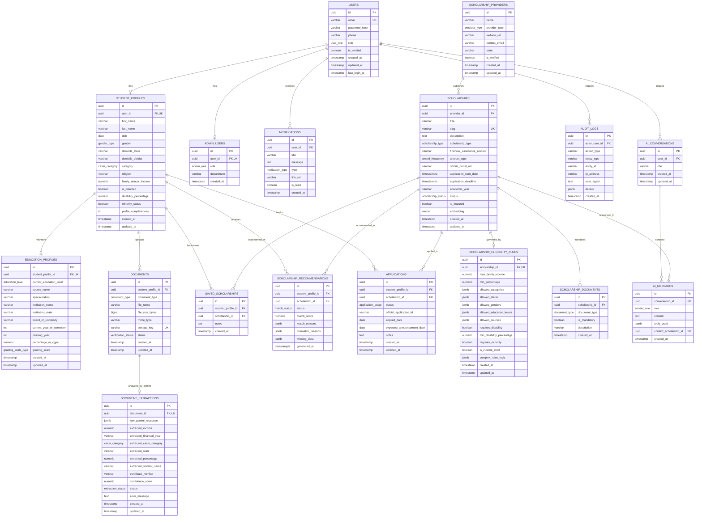

# Database Schema Specification

## Project: ScholarSathi
**Document Version:** 1.0.0  
**Database Engine:** PostgreSQL 15+ (with `pgvector` and `uuid-ossp` extensions)  
**ORM / Migration Tool Compatibility:** Prisma / Drizzle / Knex / Raw SQL Migrations

---

## 1. Entity Relationship Overview

The ScholarSathi database is engineered for ACID-compliant transactional consistency, high-speed relational queries, machine-checkable eligibility evaluation, and semantic vector similarity search. Raw document files are **never** stored inside PostgreSQL; instead, private object storage references (`storage_key`) and sanitized extracted metadata are maintained.

### 1.1 Complete Mermaid ER Diagram



---

## 2. PostgreSQL Enumerated Types (ENUMs)

To guarantee database-level validation and eliminate invalid string states, the following ENUM types are defined:

```sql
CREATE EXTENSION IF NOT EXISTS "uuid-ossp";
CREATE EXTENSION IF NOT EXISTS "vector";

-- User access roles
CREATE TYPE user_role AS ENUM ('STUDENT', 'ADMIN', 'SUPER_ADMIN');

-- Gender types
CREATE TYPE gender_type AS ENUM ('MALE', 'FEMALE', 'TRANSGENDER', 'OTHER');

-- Recognized social categories in India
CREATE TYPE caste_category AS ENUM ('GENERAL', 'OBC', 'SC', 'ST', 'EWS', 'OTHER');

-- Academic levels
CREATE TYPE education_level AS ENUM (
  'CLASS_10', 'CLASS_12', 'DIPLOMA', 'UNDERGRADUATE', 'POSTGRADUATE', 'DOCTORATE'
);

-- Grading scale
CREATE TYPE grading_scale_type AS ENUM ('PERCENTAGE', 'CGPA_10', 'CGPA_4');

-- Scholarship providers
CREATE TYPE provider_type AS ENUM (
  'GOVERNMENT_CENTRAL', 'GOVERNMENT_STATE', 'PRIVATE_TRUST', 'CORPORATE_CSR', 'NGO'
);

-- Scholarship types
CREATE TYPE scholarship_type AS ENUM (
  'MERIT_BASED', 'MEANS_BASED', 'MERIT_CUM_MEANS', 'TALENT_SPORTS', 'SPECIAL_NEED'
);

-- Award frequency
CREATE TYPE award_frequency AS ENUM ('ONE_TIME', 'ANNUAL', 'MONTHLY', 'COURSE_DURATION');

-- Scholarship status
CREATE TYPE scholarship_status AS ENUM ('DRAFT', 'ACTIVE', 'EXPIRED', 'ARCHIVED');

-- Document classification
CREATE TYPE document_type AS ENUM (
  'INCOME_CERTIFICATE',
  'CASTE_CERTIFICATE',
  'DOMICILE_CERTIFICATE',
  'MARKSHEET_10TH',
  'MARKSHEET_12TH',
  'COLLEGE_MARKSHEET',
  'AADHAAR_CARD',
  'DISABILITY_CERTIFICATE',
  'BONAFIDE_CERTIFICATE',
  'FEE_RECEIPT',
  'OTHER'
);

-- Document verification lifecycle
CREATE TYPE verification_status AS ENUM ('PENDING', 'EXTRACTED', 'VERIFIED', 'REJECTED');

-- AI extraction status
CREATE TYPE extraction_status AS ENUM ('PROCESSING', 'SUCCESS', 'FAILED', 'MANUALLY_OVERRIDDEN');

-- Deterministic eligibility status
CREATE TYPE match_status AS ENUM ('ELIGIBLE', 'LIKELY_ELIGIBLE', 'NEEDS_VERIFICATION', 'NOT_ELIGIBLE');

-- Student application tracking stage
CREATE TYPE application_stage AS ENUM (
  'SAVED', 'APPLIED_ON_OFFICIAL_PORTAL', 'UNDER_REVIEW', 'AWARDED', 'REJECTED'
);

-- Notification types
CREATE TYPE notification_type AS ENUM (
  'DEADLINE_REMINDER', 'ELIGIBILITY_MATCH', 'DOCUMENT_EXTRACTION', 'SYSTEM_UPDATE'
);

-- AI message senders
CREATE TYPE sender_role AS ENUM ('USER', 'ASSISTANT', 'SYSTEM');

-- Admin roles
CREATE TYPE admin_role AS ENUM ('DATA_MANAGER', 'AUDITOR', 'SUPER_ADMIN');
```

---

## 3. Comprehensive Table DDL Specifications

---

### Table 1: `users`
Core identity table storing credentials and system role.

```sql
CREATE TABLE users (
    id UUID PRIMARY KEY DEFAULT uuid_generate_v4(),
    email VARCHAR(255) NOT NULL UNIQUE,
    password_hash VARCHAR(255) NOT NULL,
    phone VARCHAR(20),
    role user_role NOT NULL DEFAULT 'STUDENT',
    is_verified BOOLEAN NOT NULL DEFAULT FALSE,
    created_at TIMESTAMPTZ NOT NULL DEFAULT NOW(),
    updated_at TIMESTAMPTZ NOT NULL DEFAULT NOW(),
    last_login_at TIMESTAMPTZ
);

CREATE INDEX idx_users_email ON users(email);
CREATE INDEX idx_users_role ON users(role);
```

---

### Table 2: `student_profiles`
Personal, socio-economic, and domicile characteristics.

```sql
CREATE TABLE student_profiles (
    id UUID PRIMARY KEY DEFAULT uuid_generate_v4(),
    user_id UUID NOT NULL UNIQUE REFERENCES users(id) ON DELETE CASCADE,
    first_name VARCHAR(100) NOT NULL,
    last_name VARCHAR(100) NOT NULL,
    dob DATE NOT NULL,
    gender gender_type NOT NULL,
    domicile_state VARCHAR(100) NOT NULL,
    domicile_district VARCHAR(100) NOT NULL,
    category caste_category NOT NULL DEFAULT 'GENERAL',
    religion VARCHAR(50),
    family_annual_income NUMERIC(12, 2) NOT NULL DEFAULT 0.00,
    is_disabled BOOLEAN NOT NULL DEFAULT FALSE,
    disability_percentage NUMERIC(5, 2),
    minority_status BOOLEAN NOT NULL DEFAULT FALSE,
    profile_completeness INT NOT NULL DEFAULT 20,
    created_at TIMESTAMPTZ NOT NULL DEFAULT NOW(),
    updated_at TIMESTAMPTZ NOT NULL DEFAULT NOW(),
    CONSTRAINT chk_disability_pct CHECK (disability_percentage IS NULL OR (disability_percentage >= 0 AND disability_percentage <= 100)),
    CONSTRAINT chk_positive_income CHECK (family_annual_income >= 0)
);

CREATE INDEX idx_student_profiles_domicile_state ON student_profiles(domicile_state);
CREATE INDEX idx_student_profiles_category ON student_profiles(category);
CREATE INDEX idx_student_profiles_income ON student_profiles(family_annual_income);
```

---

### Table 3: `education_profiles`
Academic records and current educational enrollment.

```sql
CREATE TABLE education_profiles (
    id UUID PRIMARY KEY DEFAULT uuid_generate_v4(),
    student_profile_id UUID NOT NULL UNIQUE REFERENCES student_profiles(id) ON DELETE CASCADE,
    current_education_level education_level NOT NULL,
    course_name VARCHAR(150) NOT NULL,
    specialization VARCHAR(150),
    institution_name VARCHAR(255) NOT NULL,
    institution_state VARCHAR(100) NOT NULL,
    board_or_university VARCHAR(255) NOT NULL,
    current_year_or_semester INT NOT NULL,
    passing_year INT NOT NULL,
    percentage_or_cgpa NUMERIC(5, 2) NOT NULL,
    grading_scale grading_scale_type NOT NULL DEFAULT 'PERCENTAGE',
    created_at TIMESTAMPTZ NOT NULL DEFAULT NOW(),
    updated_at TIMESTAMPTZ NOT NULL DEFAULT NOW(),
    CONSTRAINT chk_score_bounds CHECK (
        (grading_scale = 'PERCENTAGE' AND percentage_or_cgpa >= 0 AND percentage_or_cgpa <= 100) OR
        (grading_scale = 'CGPA_10' AND percentage_or_cgpa >= 0 AND percentage_or_cgpa <= 10) OR
        (grading_scale = 'CGPA_4' AND percentage_or_cgpa >= 0 AND percentage_or_cgpa <= 4)
    )
);

CREATE INDEX idx_education_profiles_level ON education_profiles(current_education_level);
CREATE INDEX idx_education_profiles_course ON education_profiles(course_name);
```

---

### Table 4: `scholarship_providers`
Government departments, corporate foundations, and philanthropic trusts.

```sql
CREATE TABLE scholarship_providers (
    id UUID PRIMARY KEY DEFAULT uuid_generate_v4(),
    name VARCHAR(255) NOT NULL,
    provider_type provider_type NOT NULL,
    website_url VARCHAR(500) NOT NULL,
    contact_email VARCHAR(255),
    state VARCHAR(100),
    is_verified BOOLEAN NOT NULL DEFAULT TRUE,
    created_at TIMESTAMPTZ NOT NULL DEFAULT NOW(),
    updated_at TIMESTAMPTZ NOT NULL DEFAULT NOW()
);

CREATE INDEX idx_providers_type ON scholarship_providers(provider_type);
```

---

### Table 5: `scholarships`
Primary scholarship listings with metadata and vector embeddings.

```sql
CREATE TABLE scholarships (
    id UUID PRIMARY KEY DEFAULT uuid_generate_v4(),
    provider_id UUID NOT NULL REFERENCES scholarship_providers(id) ON DELETE RESTRICT,
    title VARCHAR(255) NOT NULL,
    slug VARCHAR(255) NOT NULL UNIQUE,
    description TEXT NOT NULL,
    scholarship_type scholarship_type NOT NULL,
    financial_assistance_amount VARCHAR(255) NOT NULL,
    amount_type award_frequency NOT NULL DEFAULT 'ANNUAL',
    official_portal_url VARCHAR(1000) NOT NULL,
    application_start_date TIMESTAMPTZ NOT NULL,
    application_deadline TIMESTAMPTZ NOT NULL,
    academic_year VARCHAR(20) NOT NULL,
    status scholarship_status NOT NULL DEFAULT 'DRAFT',
    is_featured BOOLEAN NOT NULL DEFAULT FALSE,
    embedding vector(768),
    created_at TIMESTAMPTZ NOT NULL DEFAULT NOW(),
    updated_at TIMESTAMPTZ NOT NULL DEFAULT NOW()
);

CREATE INDEX idx_scholarships_deadline ON scholarships(application_deadline);
CREATE INDEX idx_scholarships_status ON scholarships(status);
CREATE INDEX idx_scholarships_provider ON scholarships(provider_id);
-- Vector similarity index for semantic search
CREATE INDEX idx_scholarships_embedding ON scholarships USING hnsw (embedding vector_cosine_ops);
```

---

### Table 6: `scholarship_eligibility_rules`
Machine-readable, structured eligibility criteria evaluated by the deterministic engine.

```sql
CREATE TABLE scholarship_eligibility_rules (
    id UUID PRIMARY KEY DEFAULT uuid_generate_v4(),
    scholarship_id UUID NOT NULL UNIQUE REFERENCES scholarships(id) ON DELETE CASCADE,
    max_family_income NUMERIC(12, 2),
    min_percentage NUMERIC(5, 2),
    allowed_categories JSONB NOT NULL DEFAULT '["GENERAL", "OBC", "SC", "ST", "EWS"]'::jsonb,
    allowed_states JSONB NOT NULL DEFAULT '["ALL"]'::jsonb,
    allowed_genders JSONB NOT NULL DEFAULT '["ALL"]'::jsonb,
    allowed_education_levels JSONB NOT NULL DEFAULT '["ALL"]'::jsonb,
    allowed_courses JSONB NOT NULL DEFAULT '["ALL"]'::jsonb,
    requires_disability BOOLEAN NOT NULL DEFAULT FALSE,
    min_disability_percentage NUMERIC(5, 2),
    requires_minority BOOLEAN NOT NULL DEFAULT FALSE,
    is_income_strict BOOLEAN NOT NULL DEFAULT TRUE,
    complex_rules_logic JSONB,
    created_at TIMESTAMPTZ NOT NULL DEFAULT NOW(),
    updated_at TIMESTAMPTZ NOT NULL DEFAULT NOW()
);

CREATE INDEX idx_rules_income ON scholarship_eligibility_rules(max_family_income);
CREATE INDEX idx_rules_min_pct ON scholarship_eligibility_rules(min_percentage);
CREATE INDEX idx_rules_categories ON scholarship_eligibility_rules USING GIN (allowed_categories);
CREATE INDEX idx_rules_states ON scholarship_eligibility_rules USING GIN (allowed_states);
CREATE INDEX idx_rules_edu_levels ON scholarship_eligibility_rules USING GIN (allowed_education_levels);
```

---

### Table 7: `scholarship_documents`
Checklist of mandatory and optional documents required by a scholarship.

```sql
CREATE TABLE scholarship_documents (
    id UUID PRIMARY KEY DEFAULT uuid_generate_v4(),
    scholarship_id UUID NOT NULL REFERENCES scholarships(id) ON DELETE CASCADE,
    document_type document_type NOT NULL,
    is_mandatory BOOLEAN NOT NULL DEFAULT TRUE,
    description VARCHAR(255),
    created_at TIMESTAMPTZ NOT NULL DEFAULT NOW(),
    CONSTRAINT uq_scholarship_doc UNIQUE(scholarship_id, document_type)
);

CREATE INDEX idx_scholarship_docs_sch ON scholarship_documents(scholarship_id);
```

---

### Table 8: `documents`
Uploaded student certificates and secure object storage pointers.

```sql
CREATE TABLE documents (
    id UUID PRIMARY KEY DEFAULT uuid_generate_v4(),
    student_profile_id UUID NOT NULL REFERENCES student_profiles(id) ON DELETE CASCADE,
    document_type document_type NOT NULL,
    file_name VARCHAR(255) NOT NULL,
    file_size_bytes BIGINT NOT NULL,
    mime_type VARCHAR(100) NOT NULL,
    storage_key VARCHAR(500) NOT NULL UNIQUE,
    status verification_status NOT NULL DEFAULT 'PENDING',
    created_at TIMESTAMPTZ NOT NULL DEFAULT NOW(),
    updated_at TIMESTAMPTZ NOT NULL DEFAULT NOW(),
    CONSTRAINT chk_doc_size CHECK (file_size_bytes > 0 AND file_size_bytes <= 5242880)
);

CREATE INDEX idx_documents_student ON documents(student_profile_id);
CREATE INDEX idx_documents_type ON documents(document_type);
CREATE INDEX idx_documents_status ON documents(status);
```

---

### Table 9: `document_extractions`
Structured data points extracted from certificates by Gemini Vision.

```sql
CREATE TABLE document_extractions (
    id UUID PRIMARY KEY DEFAULT uuid_generate_v4(),
    document_id UUID NOT NULL UNIQUE REFERENCES documents(id) ON DELETE CASCADE,
    raw_gemini_response JSONB,
    extracted_income NUMERIC(12, 2),
    extracted_financial_year VARCHAR(20),
    extracted_caste_category caste_category,
    extracted_state VARCHAR(100),
    extracted_percentage NUMERIC(5, 2),
    extracted_student_name VARCHAR(150),
    certificate_number VARCHAR(100),
    confidence_score NUMERIC(4, 3) NOT NULL DEFAULT 0.000,
    status extraction_status NOT NULL DEFAULT 'PROCESSING',
    error_message TEXT,
    created_at TIMESTAMPTZ NOT NULL DEFAULT NOW(),
    updated_at TIMESTAMPTZ NOT NULL DEFAULT NOW()
);

CREATE INDEX idx_extractions_document ON document_extractions(document_id);
CREATE INDEX idx_extractions_status ON document_extractions(status);
```

---

### Table 10: `saved_scholarships`
Student bookmarks for later review.

```sql
CREATE TABLE saved_scholarships (
    id UUID PRIMARY KEY DEFAULT uuid_generate_v4(),
    student_profile_id UUID NOT NULL REFERENCES student_profiles(id) ON DELETE CASCADE,
    scholarship_id UUID NOT NULL REFERENCES scholarships(id) ON DELETE CASCADE,
    notes TEXT,
    created_at TIMESTAMPTZ NOT NULL DEFAULT NOW(),
    CONSTRAINT uq_student_saved_scholarship UNIQUE(student_profile_id, scholarship_id)
);

CREATE INDEX idx_saved_student ON saved_scholarships(student_profile_id);
```

---

### Table 11: `scholarship_recommendations`
Output cache of deterministic eligibility matching and composite ranking.

```sql
CREATE TABLE scholarship_recommendations (
    id UUID PRIMARY KEY DEFAULT uuid_generate_v4(),
    student_profile_id UUID NOT NULL REFERENCES student_profiles(id) ON DELETE CASCADE,
    scholarship_id UUID NOT NULL REFERENCES scholarships(id) ON DELETE CASCADE,
    status match_status NOT NULL,
    match_score NUMERIC(5, 2) NOT NULL,
    match_reasons JSONB NOT NULL DEFAULT '[]'::jsonb,
    mismatch_reasons JSONB NOT NULL DEFAULT '[]'::jsonb,
    missing_data JSONB NOT NULL DEFAULT '[]'::jsonb,
    generated_at TIMESTAMPTZ NOT NULL DEFAULT NOW(),
    CONSTRAINT uq_student_recommendation UNIQUE(student_profile_id, scholarship_id)
);

CREATE INDEX idx_recommendations_student ON scholarship_recommendations(student_profile_id);
CREATE INDEX idx_recommendations_status ON scholarship_recommendations(status);
CREATE INDEX idx_recommendations_score ON scholarship_recommendations(match_score DESC);
```

---

### Table 12: `applications`
Student application tracking ledger with official portal reference codes.

```sql
CREATE TABLE applications (
    id UUID PRIMARY KEY DEFAULT uuid_generate_v4(),
    student_profile_id UUID NOT NULL REFERENCES student_profiles(id) ON DELETE CASCADE,
    scholarship_id UUID NOT NULL REFERENCES scholarships(id) ON DELETE CASCADE,
    status application_stage NOT NULL DEFAULT 'SAVED',
    official_application_id VARCHAR(100),
    applied_date DATE,
    expected_announcement_date DATE,
    notes TEXT,
    created_at TIMESTAMPTZ NOT NULL DEFAULT NOW(),
    updated_at TIMESTAMPTZ NOT NULL DEFAULT NOW(),
    CONSTRAINT uq_student_application UNIQUE(student_profile_id, scholarship_id)
);

CREATE INDEX idx_applications_student ON applications(student_profile_id);
CREATE INDEX idx_applications_status ON applications(status);
```

---

### Table 13: `notifications`
In-app deadline alerts, document verification notices, and match announcements.

```sql
CREATE TABLE notifications (
    id UUID PRIMARY KEY DEFAULT uuid_generate_v4(),
    user_id UUID NOT NULL REFERENCES users(id) ON DELETE CASCADE,
    title VARCHAR(255) NOT NULL,
    message TEXT NOT NULL,
    type notification_type NOT NULL,
    link_url VARCHAR(500),
    is_read BOOLEAN NOT NULL DEFAULT FALSE,
    created_at TIMESTAMPTZ NOT NULL DEFAULT NOW()
);

CREATE INDEX idx_notifications_user_unread ON notifications(user_id, is_read);
```

---

### Table 14: `ai_conversations`
Thread containers for student interactions with Gemini Assistant.

```sql
CREATE TABLE ai_conversations (
    id UUID PRIMARY KEY DEFAULT uuid_generate_v4(),
    user_id UUID NOT NULL REFERENCES users(id) ON DELETE CASCADE,
    title VARCHAR(255) NOT NULL DEFAULT 'Scholarship Guidance Session',
    created_at TIMESTAMPTZ NOT NULL DEFAULT NOW(),
    updated_at TIMESTAMPTZ NOT NULL DEFAULT NOW()
);

CREATE INDEX idx_ai_conv_user ON ai_conversations(user_id);
```

---

### Table 15: `ai_messages`
Individual conversational turns with tool execution logs.

```sql
CREATE TABLE ai_messages (
    id UUID PRIMARY KEY DEFAULT uuid_generate_v4(),
    conversation_id UUID NOT NULL REFERENCES ai_conversations(id) ON DELETE CASCADE,
    role sender_role NOT NULL,
    content TEXT NOT NULL,
    tools_used JSONB,
    context_scholarship_id UUID REFERENCES scholarships(id) ON DELETE SET NULL,
    created_at TIMESTAMPTZ NOT NULL DEFAULT NOW()
);

CREATE INDEX idx_ai_messages_conv ON ai_messages(conversation_id, created_at);
```

---

### Table 16: `admin_users`
Role-based privilege metadata for platform operators and data managers.

```sql
CREATE TABLE admin_users (
    id UUID PRIMARY KEY DEFAULT uuid_generate_v4(),
    user_id UUID NOT NULL UNIQUE REFERENCES users(id) ON DELETE CASCADE,
    role admin_role NOT NULL DEFAULT 'DATA_MANAGER',
    department VARCHAR(100),
    created_at TIMESTAMPTZ NOT NULL DEFAULT NOW()
);

CREATE INDEX idx_admin_users_role ON admin_users(role);
```

---

### Table 17: `audit_logs`
Immutable compliance and security trail for administrative and sensitive actions.

```sql
CREATE TABLE audit_logs (
    id UUID PRIMARY KEY DEFAULT uuid_generate_v4(),
    actor_user_id UUID REFERENCES users(id) ON DELETE SET NULL,
    action_type VARCHAR(100) NOT NULL,
    entity_type VARCHAR(100) NOT NULL,
    entity_id VARCHAR(100) NOT NULL,
    ip_address VARCHAR(45) NOT NULL,
    user_agent TEXT,
    details JSONB,
    created_at TIMESTAMPTZ NOT NULL DEFAULT NOW()
);

CREATE INDEX idx_audit_logs_actor ON audit_logs(actor_user_id);
CREATE INDEX idx_audit_logs_action ON audit_logs(action_type);
CREATE INDEX idx_audit_logs_created ON audit_logs(created_at DESC);
```

---

## 4. Performance Indexes & JSONB Querying Strategies

### 4.1 Indexing Rationale
1. **B-Tree on Foreign Keys & Enums:** All foreign key relationships (`user_id`, `scholarship_id`, `student_profile_id`) and status columns are indexed with standard B-tree indexes for $O(\log N)$ joins and filter performance.
2. **GIN Indexes on Machine Rules:** The `scholarship_eligibility_rules` table utilizes Generalized Inverted Indexes (GIN) on JSONB arrays (`allowed_categories`, `allowed_states`, `allowed_education_levels`). This allows the deterministic engine to query matching scholarships in under 10 milliseconds:
   ```sql
   -- Instant array containment check via GIN index
   SELECT scholarship_id FROM scholarship_eligibility_rules 
   WHERE allowed_categories ? 'OBC' 
     AND (allowed_states ? 'Maharashtra' OR allowed_states ? 'ALL')
     AND max_family_income >= 235000;
   ```
3. **HNSW Index on pgvector:** Vector similarity search on `scholarships.embedding` uses the Hierarchical Navigable Small World (HNSW) cosine metric for ultra-fast semantic similarity retrieval across candidate scholarships.
