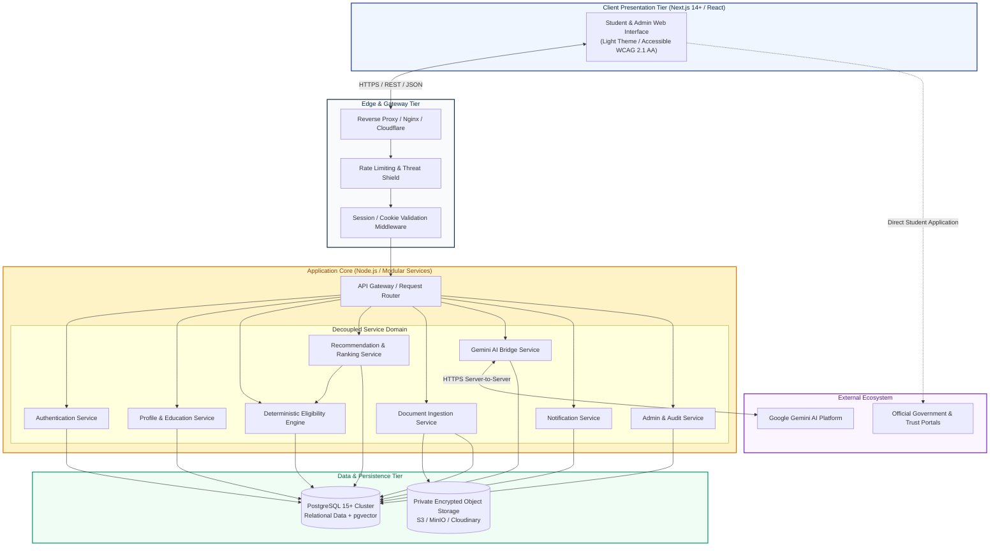
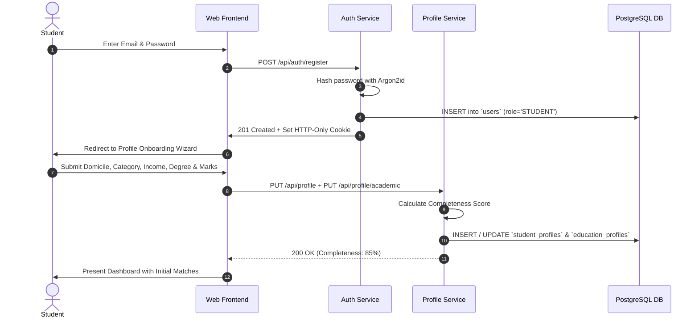
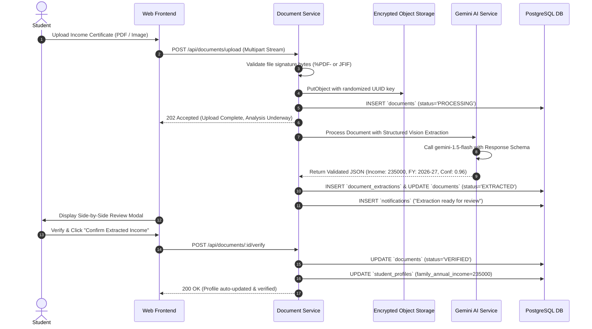
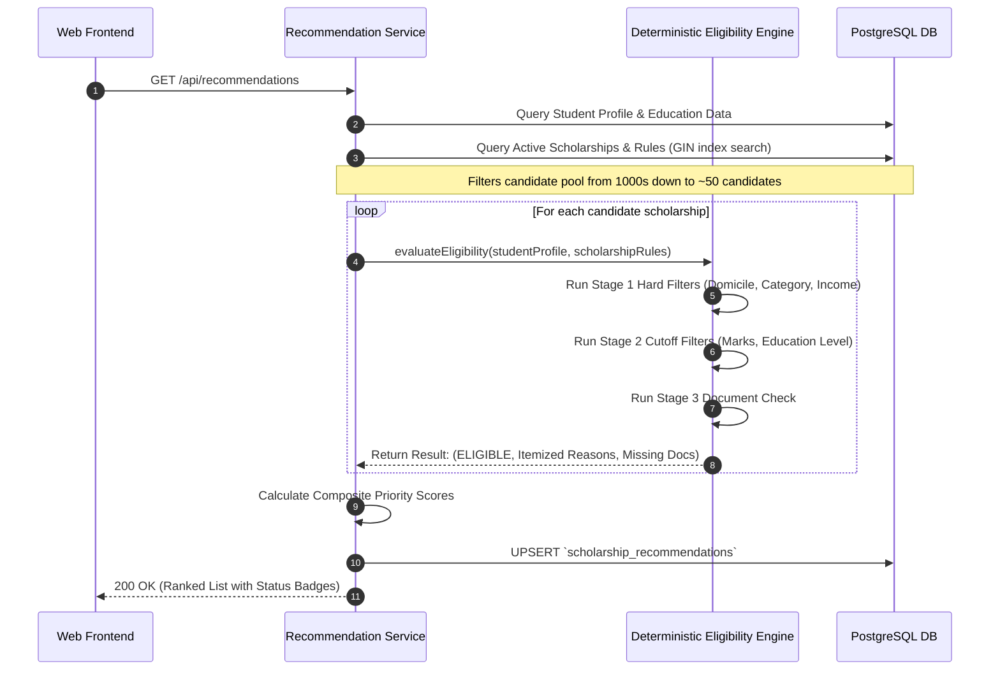
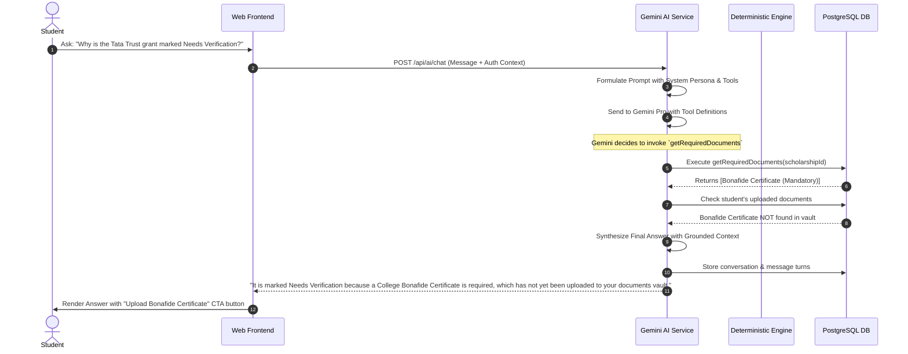
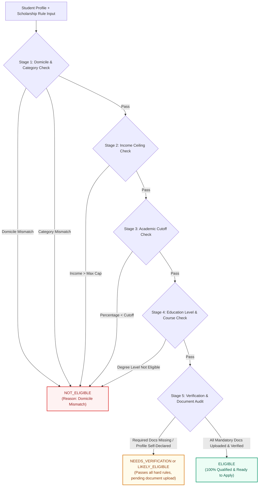
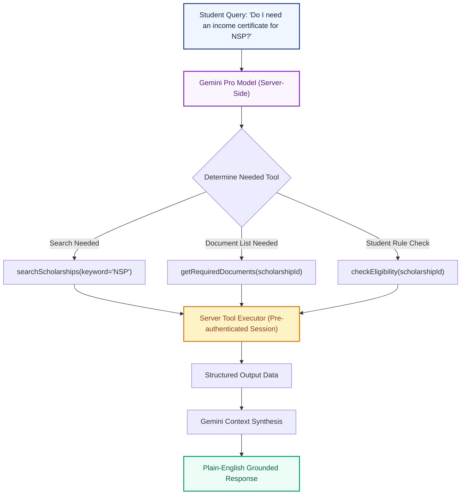

# System Design Document

## Project: ScholarSathi
**Document Version:** 1.0.0  
**Status:** Approved for Core Engineering  
**Architecture Pattern:** Modular Monolith with Clean Architecture & Pure Functional Rule Engine

---

## 1. High-Level Architecture Overview

ScholarSathi is designed to provide high throughput, extreme reliability, and sub-second deterministic rule processing while isolating AI operations into non-blocking, sandboxed pipelines.



---

## 2. Component Architecture & Service Boundaries

ScholarSathi uses a **Modular Monolith** architecture with strict domain boundaries. This eliminates the operational overhead of microservices while maintaining clean dependency isolation.

### 2.1 Component Catalog

1. **Frontend Presentation Component (`frontend/`):**
   - Built on Next.js 14+ App Router, utilizing Server Components for public catalog indexing and Client Components for interactive dashboards, forms, and the AI assistant.
2. **Authentication Service (`services/auth/`):**
   - Enforces Argon2id hashing, generates and rotates HTTP-Only SameSite session cookies, and handles role verification (`STUDENT`, `ADMIN`, `SUPER_ADMIN`).
3. **Student Profile Service (`services/profile/`):**
   - Manages personal, demographic, category, and academic attributes. Computes the dynamic Profile Completeness Score (0–100%).
4. **Scholarship Catalog Service (`services/scholarship/`):**
   - Provides faceted full-text search, provider registration, category taxonomy, and links to verified official application portals.
5. **Deterministic Eligibility Engine (`services/engine/`):**
   - Pure, stateless, mathematical evaluation module. Evaluates student profile attributes against structured rule records. Has **zero** dependency on LLMs.
6. **Recommendation & Ranking Service (`services/recommendation/`):**
   - Orchestrates candidate retrieval, runs candidate scholarships through the Deterministic Eligibility Engine, applies the multi-factor ranking formula, and persists recommendation scores.
7. **Document Ingestion Service (`services/document/`):**
   - Validates file streams (magic number check), persists encrypted binaries into private object storage, generates 15-minute presigned URLs, and dispatches extraction jobs.
8. **Gemini AI Service (`services/ai/`):**
   - Server-side interface to Google Gemini models. Manages extraction prompts, enforces JSON schemas, and coordinates tool-calling functions for the conversational assistant.
9. **Notification Service (`services/notification/`):**
   - Evaluates deadline urgency (7 days, 3 days, 1 day) and dispatches in-app notifications to affected students.
10. **Admin & Audit Service (`services/admin/`):**
    - Governs administrative operations, scholarship rule building, provider verification, and immutable audit logging.

---

## 3. End-to-End System Data Flows

---

### 3.1 Data Flow 1: Student Registration & Profile Creation



---

### 3.2 Data Flow 2: Document Ingestion, Gemini Extraction, & Verification



---

### 3.3 Data Flow 3: Deterministic Recommendation Pipeline



---

### 3.4 Data Flow 4: Conversational AI Assistant with Tool Execution



---

## 4. The Deterministic Eligibility Engine

The Deterministic Eligibility Engine is the mathematical core of ScholarSathi. **It never uses probabilistic models or LLMs to determine rule satisfaction.**

### 4.1 Multi-Stage Evaluation Pipeline



### 4.2 Deterministic Engine Implementation Specification

```typescript
export interface RuleEvaluationResult {
  status: 'ELIGIBLE' | 'LIKELY_ELIGIBLE' | 'NEEDS_VERIFICATION' | 'NOT_ELIGIBLE';
  matchReasons: string[];
  mismatchReasons: string[];
  missingDocuments: string[];
}

export function evaluateScholarshipEligibility(
  student: StudentProfileData,
  education: EducationProfileData,
  rules: ScholarshipEligibilityRules,
  uploadedDocs: DocumentRecord[]
): RuleEvaluationResult {
  const matchReasons: string[] = [];
  const mismatchReasons: string[] = [];
  const missingDocuments: string[] = [];

  // 1. Domicile Check
  const allowedStates = rules.allowedStates; // e.g. ["Maharashtra", "ALL"]
  if (!allowedStates.includes("ALL") && !allowedStates.includes(student.domicileState)) {
    mismatchReasons.push(`Domicile state '${student.domicileState}' is not eligible. Allowed: ${allowedStates.join(', ')}.`);
  } else {
    matchReasons.push(`Domicile '${student.domicileState}' meets eligibility.`);
  }

  // 2. Category Check
  const allowedCategories = rules.allowedCategories;
  if (!allowedCategories.includes(student.category)) {
    mismatchReasons.push(`Social category '${student.category}' is not eligible for this scheme.`);
  } else {
    matchReasons.push(`Category '${student.category}' is eligible.`);
  }

  // 3. Family Annual Income Check
  if (rules.maxFamilyIncome !== null) {
    if (student.familyAnnualIncome > rules.maxFamilyIncome) {
      mismatchReasons.push(
        `Family income ₹${student.familyAnnualIncome.toLocaleString('en-IN')} exceeds maximum limit of ₹${rules.maxFamilyIncome.toLocaleString('en-IN')}.`
      );
    } else {
      matchReasons.push(
        `Family income ₹${student.familyAnnualIncome.toLocaleString('en-IN')} is within the limit of ₹${rules.maxFamilyIncome.toLocaleString('en-IN')}.`
      );
    }
  }

  // 4. Academic Cutoff Check
  if (rules.minPercentage !== null) {
    if (education.percentageOrCgpa < rules.minPercentage) {
      mismatchReasons.push(
        `Academic score ${education.percentageOrCgpa}% is below the required cutoff of ${rules.minPercentage}%.`
      );
    } else {
      matchReasons.push(
        `Academic score ${education.percentageOrCgpa}% satisfies the minimum cutoff of ${rules.minPercentage}%.`
      );
    }
  }

  // 5. Gender Filter Check
  if (!rules.allowedGenders.includes("ALL") && !rules.allowedGenders.includes(student.gender)) {
    mismatchReasons.push(`Scholarship is restricted to ${rules.allowedGenders.join(', ')} applicants.`);
  }

  // Immediate Hard Rejection
  if (mismatchReasons.length > 0) {
    return {
      status: 'NOT_ELIGIBLE',
      matchReasons,
      mismatchReasons,
      missingDocuments
    };
  }

  // 6. Document & Verification Audit
  const verifiedDocTypes = uploadedDocs
    .filter(doc => doc.status === 'VERIFIED')
    .map(doc => doc.documentType);

  const mandatoryDocTypes = rules.mandatoryDocuments || [];
  for (const docType of mandatoryDocTypes) {
    if (!verifiedDocTypes.includes(docType)) {
      missingDocuments.push(docType);
    }
  }

  if (missingDocuments.length > 0) {
    return {
      status: 'NEEDS_VERIFICATION',
      matchReasons,
      mismatchReasons,
      missingDocuments
    };
  }

  // All criteria and documents fully verified
  return {
    status: 'ELIGIBLE',
    matchReasons,
    mismatchReasons,
    missingDocuments: []
  };
}
```

---

## 5. AI Assistant & Tool-Calling Architecture

The conversational assistant operates via **ReAct (Reasoning + Acting)** tool calling. It never directly accesses raw SQL tables. Instead, it interacts exclusively with strictly scoped helper functions:



---

## 6. Multi-Factor Recommendation Pipeline

The recommendation pipeline runs in four distinct phases:
1. **Candidate Retrieval (Database & Vector Filter):**
   - High-speed SQL query using GIN indexes on `allowed_states` and `allowed_categories`.
   - Semantic similarity search using `pgvector` on course names and career goals.
2. **Rule Filtering (Deterministic Engine):**
   - Candidate list evaluated through `evaluateScholarshipEligibility()`.
3. **Multi-Factor Ranking:**
   - Composite priority calculation:
     $$\text{Score} = (0.50 \times \text{Status}) + (0.25 \times \text{Deadline}) + (0.15 \times \text{Benefit}) + (0.10 \times \text{DocCompleteness})$$
4. **Explanation Generation:**
   - Pre-computed template strings or lightweight Gemini synthesis for plain-English display.

---

## 7. Reliability, Resilience & Graceful Degradation

| Failure Mode | Detection / Trigger | Impact | Resilience & Fallback Mechanism |
| :--- | :--- | :--- | :--- |
| **Gemini API Outage / Rate Limit** | HTTP 500 / 429 from Google API | Document OCR extraction or chat assistant stalls | **Graceful Degradation:** The student is prompted to enter certificate values manually. Core search, deterministic eligibility matching, and official application links continue operating with zero degradation. |
| **Document OCR Parse Failure** | Extraction confidence < 0.70 or unreadable scan | Certificate details cannot be reliably extracted | **Human-in-the-Loop:** System flags the extraction, highlights unreadable fields, and presents a manual confirmation screen to the student. |
| **Official Portal Downtime** | External government portal (NSP / MahaDBT) is slow or unreachable | Student clicking "Apply" cannot load portal | **Informational Caching:** ScholarSathi maintains cached instructions, offline guidelines, and required document checklists so students can prepare documents while waiting for the portal to recover. |
| **PostgreSQL Connection Spike** | Active pool connections exceed 90% | API latency increases | **PgBouncer Connection Pooling:** Limits open backend connections to 100 while serving up to 5,000 pooled client connections with transaction-level reuse. |
