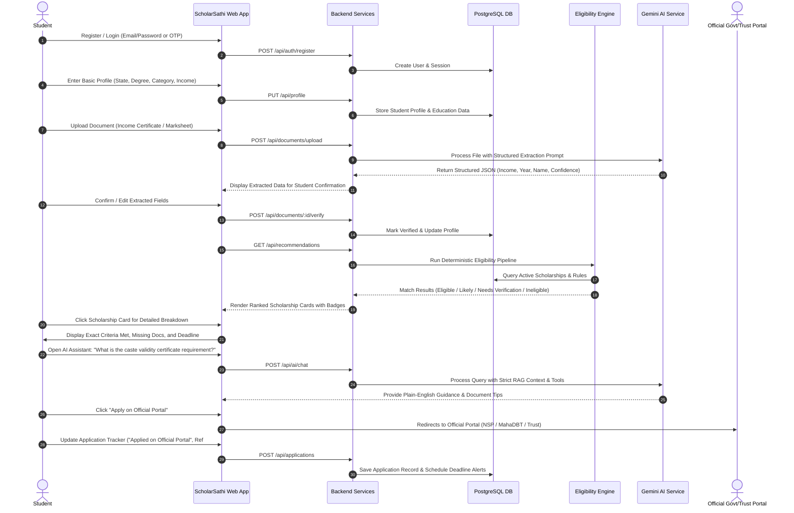
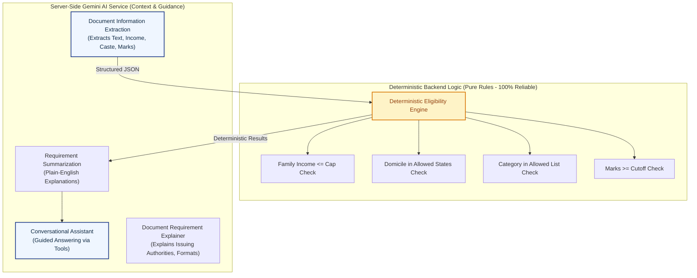
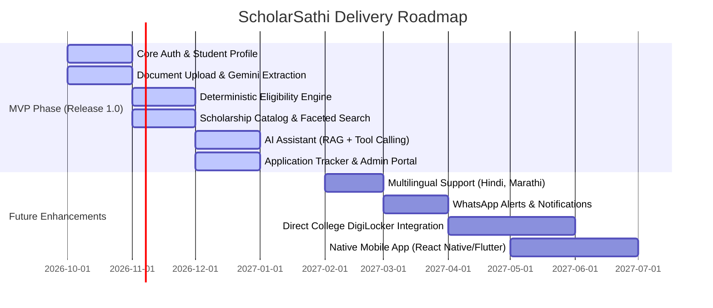

# Product Requirements Document (PRD)

## Project: ScholarSathi
**Document Version:** 1.0.0  
**Status:** Approved for Technical Architecture  
**Target Region:** India (Central, State, and Private/CSR Scholarship Ecosystems)

---

## 1. Product Overview

### 1.1 Product Name
**ScholarSathi** (*"Your Trusted Scholarship Companion"*)

### 1.2 Product Vision
To democratize access to higher and technical education in India by creating the most reliable, transparent, and intelligent scholarship discovery and eligibility matching platform. ScholarSathi empowers students from all socio-economic backgrounds—especially those in Tier-2/3 cities and rural districts—to discover, evaluate, prepare for, and track government and private scholarships without falling prey to misinformation, predatory middle-men, or expired deadlines.

### 1.3 Problem Statement
The Indian scholarship ecosystem distributes over ₹25,000 Crores annually across central ministries (National Scholarship Portal - NSP), state departments (e.g., MahaDBT, SSP Karnataka, Medhabruti Odisha), corporate CSR foundations (Tata, Reliance, Infosys, HDFC), and philanthropic trusts. However:
1. **Extreme Fragmentation:** Eligibility criteria and application windows are scattered across hundreds of isolated websites with inconsistent terminology.
2. **Opaque Eligibility Rules:** Complex combinations of domicile, social category (SC/ST/OBC/EWS/General), minority status, annual parental income ceilings, gender preferences, and minimum academic cutoffs overwhelm students.
3. **Severe Verification Friction:** Students often discover after days of preparation that an income certificate format is obsolete or their caste certificate is missing an issuing authority seal.
4. **Missed Deadlines:** Critical application windows are short (often 3 to 6 weeks) and announced with little notice, resulting in millions of rupees in unutilized funds.
5. **Vulnerability to Scams:** Students frequently pay fraudulent agents who guarantee scholarship awards.

### 1.4 Target Users
1. **Indian Students:** Pre-matric, post-matric, higher secondary (11th/12th), undergraduate (B.Tech, B.Sc, B.Com, MBBS, etc.), postgraduate, and doctoral students.
2. **Parents & Guardians:** Sponsoring and assisting first-generation learners in family financial planning.
3. **Scholarship Administrators & Data Managers:** Trust officers, state nodal officers, and CSR program managers responsible for publishing and maintaining accurate scholarship terms.
4. **Platform Administrators:** ScholarSathi operations teams ensuring data hygiene, security, and rule accuracy.

### 1.5 Primary Use Cases
- A 2nd-year B.Tech student in Maharashtra from an OBC family earning ₹2.2 Lakh/year searches for state fee reimbursement and corporate merit-cum-means grants.
- A high-school girl in Uttar Pradesh uploads her mark sheet and income certificate to quickly verify which government schemes she qualifies for before the academic year begins.
- A student uses the conversational AI assistant to understand why a specific scholarship rejected their category or what alternative documents can serve as proof of income.
- A student tracks 4 different applications across NSP and private trust portals with deadline countdowns and document checklists.

### 1.6 Product Goals
- **Deterministic Accuracy:** Eliminate false hopes by executing pure, deterministic rule-matching on hard criteria (income, domicile, caste, marks).
- **Reduced Onboarding Friction:** Reduce profile completion and document qualification time from days to under 5 minutes using Gemini document extraction.
- **100% Legitimate Channels:** Every scholarship must link exclusively to verified, official application portals (NSP, state government DBT domains, official corporate foundation sites).
- **Informed Preparedness:** Provide an actionable required-documents checklist for every scholarship so students have valid paperwork ready before clicking "Apply".

### 1.7 Non-Goals (Out of Scope for Core Platform)
- ScholarSathi is **NOT** a scholarship disbursal agency; it never collects application processing fees or transfers grant funds directly to student bank accounts.
- ScholarSathi does **NOT** replace official government portals (e.g., NSP, MahaDBT); final submission occurs on the respective official government or trust portal.
- ScholarSathi does **NOT** guarantee scholarship approval; awards remain the sovereign discretion of the respective provider or jury.
- ScholarSathi will **NOT** use probabilistic AI models to make final legal determinations of eligibility.

---

## 2. User Personas

### 2.1 Persona 1: The Student (Primary)
- **Name:** Ramesh Patil
- **Profile:** 19 years old, 2nd-year B.Tech (Computer Engineering) student at a government-aided college in Pune, Maharashtra. Domicile: Maharashtra. Category: OBC. Family Annual Income: ₹2,35,000. 12th Board Marks: 78.4%. First-generation engineer.
- **Goals:**
  - Find state government tuition fee waivers and private corporate CSR scholarships for engineering tuition.
  - Understand whether his family income certificate (valid until March 2027) qualifies for the ₹2.5 Lakh income ceiling.
  - Track application deadlines so he doesn't miss the 3-week window in September/October.
- **Problems:**
  - MahaDBT portal has confusing scheme names (e.g., Rajarshi Chhatrapati Shahu Maharaj Shikshan Shulkh Shishyavrutti Yojna).
  - Unsure whether private trust scholarships can be held concurrently with government scholarships.
  - Slow 4G mobile internet connection and limited access to desktop scanners.
- **Main Actions:**
  - Signs up via mobile/email.
  - Uploads photo/PDF of income certificate and mark sheet.
  - Reviews filtered, ranked scholarships with clear "Eligible" tags.
  - Uses AI assistant: *"Can I apply for both MahaDBT fee reimbursement and a Tata Trust scholarship?"*
  - Clicks official portal link and tracks submission status in his dashboard.

### 2.2 Persona 2: The Scholarship Administrator / Data Manager
- **Name:** Anand Swaminathan
- **Profile:** 38 years old, Program Officer at a national corporate foundation running higher education CSR grants across India.
- **Goals:**
  - Publish accurate, structured criteria for the 2026-27 engineering scholarship cycle.
  - Ensure applicants satisfy mandatory minimums (e.g., Girls in STEM, family income < ₹3 Lakh, state quota) before they flood the foundation's portal.
- **Problems:**
  - Over 60% of applications received on their main website are invalid due to students failing basic income or domicile criteria.
  - Difficult to update deadlines or quota amendments in real-time across disparate aggregator blogs.
- **Responsibilities:**
  - Define structured eligibility rules (JSON criteria, cutoff percentages, mandatory document lists).
  - Keep official application URLs, start dates, and closing dates updated.
  - Review data validation logs and query reports.
- **Main Actions:**
  - Logs into ScholarSathi Admin Portal.
  - Creates/edits scholarship records using the Structured Rule Builder.
  - Previews how the deterministic eligibility engine evaluates sample student profiles against the new rule.
  - Publishes updates with immediate sync to student recommendation feeds.

### 2.3 Persona 3: Platform Administrator / Compliance Officer
- **Name:** Sunita Rao
- **Profile:** 34 years old, Senior Operations and Compliance Lead at ScholarSathi.
- **Goals:**
  - Ensure zero malicious or fake scholarships are listed on the platform.
  - Monitor Gemini document extraction latency, error rates, and token safety.
  - Maintain data privacy compliance with India's Digital Personal Data Protection Act (DPDPA 2023).
- **Problems:**
  - Needs audit trails for every edit made to scholarship eligibility rules.
  - Must monitor automated OCR/Gemini extraction errors to prevent misleading student records.
- **Responsibilities:**
  - Oversee platform health, user verification rates, and system uptime.
  - Manage RBAC permissions for data managers.
  - Review flagged documents, extraction edge cases, and user feedback.
- **Main Actions:**
  - Reviews audit logs for all administrative actions.
  - Inspects system health dashboards and AI service error rates.
  - Deactivates expired or suspicious scholarship listings.

---

## 3. Core User Journey

The end-to-end journey is designed to be frictionless, transparent, and reassuring:

---

## 4. Product Features

### 4.1 Authentication & User Management
- Support secure email/password registration with password strength indicators.
- Optional Google OAuth 2.0 PKCE flow for rapid one-click student onboarding.
- Multi-factor authentication (MFA) capability for Administrative accounts.
- Session management with automatic timeout after 7 days of inactivity.

### 4.2 Student Profile Management
- **Personal Details:** Full name, date of birth, gender, domicile state, domicile district, minority status, disability status (yes/no, percentage if yes).
- **Social Category:** General, OBC (Creamy/Non-Creamy), SC, ST, EWS.
- **Financial Profile:** Annual family income in Indian Rupees (INR), number of earning family members, source of income certificate.
- **Academic Profile:** Current education level (10th, 12th, Diploma, UG, PG, Doctorate), course title, department/specialization, institution name and state, affiliated university/board, current academic year/semester, cumulative percentage or CGPA, passing year.

### 4.3 Scholarship Search & Faceted Filtering
- Real-time search across scholarship titles, provider names, and course keywords.
- Multi-dimensional filters:
  - **Provider Type:** Central Government (NSP), State Government, Corporate CSR, Private Charitable Trust, International/Exchange.
  - **Education Level:** High School, Diploma, Undergraduate, Postgraduate, PhD.
  - **Social Category:** SC, ST, OBC, EWS, General, Minority.
  - **Gender:** All, Female Only, Transgender.
  - **State of Domicile:** Specific Indian States/UTs or Pan-India.
  - **Annual Benefit Amount:** Range slider (₹5,000 to ₹5,00,000+).
  - **Application Status:** Currently Open, Opening Soon, Closed.

### 4.4 Deterministic Eligibility Matching
- Hard criteria validation engine comparing student attributes against machine-readable scholarship rules.
- Transparent match evaluation output:
  - **Eligible:** All hard rules strictly satisfied; student meets domicile, category, income cap, and academic cutoffs.
  - **Likely Eligible:** Satisfies all core criteria, but requires an optional document or has minor unverified self-declared fields.
  - **Needs Verification:** Student has not uploaded the required certificate (e.g., income certificate missing) or self-declared data needs admin/document proof.
  - **Not Eligible:** Explicitly fails at least one hard condition (e.g., income exceeds cap, wrong domicile state, marks below cutoff).
- Explicit, human-readable breakdown of every rule evaluation (e.g., *"✓ Income ₹2,35,000 is under the maximum limit of ₹2,50,000"* vs *"✗ Minimum marks required is 80%; your score is 78.4%"*).

### 4.5 AI Scholarship Assistant (Powered by Gemini)
- Context-aware chatbot grounded exclusively in verified scholarship data and student profile metadata.
- Pre-built quick action prompts:
  - *"Explain why I am eligible or ineligible for this scholarship."*
  - *"What documents do I need to prepare before applying?"*
  - *"How do I get an income certificate issued in Maharashtra?"*
  - *"Can I hold this private scholarship alongside my government post-matric scholarship?"*
- Tool-calling integration enabling the AI to look up active scholarships, check document requirements, and inspect application status dynamically.
- Strict guardrails: Gemini is prohibited from guessing eligibility without consulting the backend engine.

### 4.6 Document Management & Gemini Extraction
- Secure document vault for students to store their educational and identity documents.
- Supported documents: Income Certificate, Caste/Category Certificate, Domicile Certificate, 10th Marksheet, 12th Marksheet, Semester/Annual Grade Cards, College Bonafide Certificate, Disability Certificate (UDID).
- **Gemini Vision Document Extraction:**
  - Automated field extraction: Certificate number, issuance date, student name, father/guardian name, annual income amount, category, board marks.
  - Confidence scoring per extracted field.
  - Student confirmation interface allowing manual correction of extracted values prior to profile synchronization.

### 4.7 Application Lifecycle Tracking
- Kanban or list-based dashboard for tracking scholarship applications.
- Status stages:
  1. `Saved / Bookmarked`
  2. `Documents In Progress`
  3. `Applied on Official Portal` (records external application number/acknowledgment ID)
  4. `Under Review by Provider`
  5. `Awarded / Disbursed` (with award amount tracking)
  6. `Rejected / Not Shortlisted`
- Custom student notes and submission date tracking.

### 4.8 Notifications & Deadline Tracking
- Smart deadline urgency indicators:
  - `Critical`: < 7 days remaining (red tag)
  - `Upcoming`: 8–21 days remaining (amber tag)
  - `Open`: > 21 days remaining (slate/navy tag)
- In-app notification center alerting students when:
  - A saved scholarship is closing in 7 days.
  - A new scholarship matching their profile is published.
  - Gemini finishes extracting data from an uploaded certificate.
  - An administrator updates the deadline for a tracked scholarship.

### 4.9 Administrator Dashboard & Scholarship Management
- **Structured Scholarship Rule Builder:**
  - Define minimum percentage cutoffs, maximum income caps, allowed categories, allowed states, eligible degree programs, and mandatory document requirements.
- **Provider Registry:** Manage central ministries, state departments, and verified private CSR foundations.
- **Data Verification Queue:** Spot-check AI document extraction results and student-reported application anomalies.
- **Audit Logs:** Immutable audit log tracking all edits to scholarship rules, application links, and system settings.

---

## 5. AI Features: Roles, Responsibilities, and Boundaries

To ensure 100% reliability and student trust, the boundary between AI reasoning and deterministic logic is strictly defined:

### 5.1 What Gemini Is Responsible For:
1. **Document Understanding & Extraction:** Ingesting uploaded images/PDFs of Indian government certificates and extracting structured fields with confidence scores.
2. **Contextual Eligibility Explanation:** Translating raw Boolean rule outcomes from the backend engine into empathetic, crystal-clear plain English explanations.
3. **Conversational Guidance:** Answering questions regarding application procedures, required government stamps, renewal guidelines, and portal navigation.
4. **Requirement Summarization:** Condensing 20-page government gazettes or trust scheme guidelines into concise bullet points.
5. **Document Readiness Assistance:** Helping students understand which local revenue officer (e.g., Tehsildar, Sub-Divisional Magistrate) issues the requisite document in their district.

### 5.2 What Gemini Must NOT Do:
1. **NO Final Rule Decisions:** Gemini must **never** be the final authority determining whether a student qualifies. All eligibility decisions are calculated by the deterministic backend engine.
2. **NO Hallucinated Schemes:** Gemini is strictly forbidden from recommending scholarships that do not exist in the ScholarSathi verified PostgreSQL database.
3. **NO Database Writes directly:** Gemini responses are treated as untrusted input and must pass schema validation before any database update occurs.
4. **NO Key Exposure:** Gemini API keys must never be exposed or called from the client application.

---

## 6. Scholarship Matching & Ranking Mechanism

### 6.1 Concrete Matching Example

**Student Profile:**
- Domicile: Maharashtra
- Course: B.Tech (2nd Year)
- Category: OBC (Non-Creamy Layer)
- Family Annual Income: ₹2,35,000
- 12th Board Marks: 78.4%
- Document Status: Income Certificate uploaded & extracted; Caste Certificate uploaded.

**Scholarship Criteria (e.g., MahaDBT Post-Matric OBC Scheme):**
- Domicile Required: Maharashtra
- Eligible Categories: OBC, VJNT, SBC
- Income Ceiling: ≤ ₹2,50,000
- Minimum Academic Cutoff: ≥ 60.0%
- Course Levels: Diploma, Undergraduate Engineering/Tech

**Engine Evaluation:**
1. `Domicile Check`: Maharashtra == Maharashtra → **PASS**
2. `Category Check`: OBC in [OBC, VJNT, SBC] → **PASS**
3. `Income Check`: ₹2,35,000 ≤ ₹2,50,000 → **PASS**
4. `Academic Cutoff Check`: 78.4% ≥ 60.0% → **PASS**
5. `Course Level Check`: Undergraduate Engineering in [Diploma, UG Engg] → **PASS**

**Result:** `ELIGIBLE`  
**Explanation:** *"You meet all 5 criteria: domicile (Maharashtra), category (OBC), income (₹2.35L is below the ₹2.50L cap), course level, and your 78.4% marks exceed the 60.0% cutoff."*

### 6.2 Transparent Eligibility Statuses
To prevent misleading students, ScholarSathi uses 4 unambiguous categorical states rather than confusing arbitrary percentages:

| Status Badge | Visual Token | Meaning | Student Action Required |
| :--- | :--- | :--- | :--- |
| **Eligible** | Green (`#059669`) | All hard criteria met and verified with uploaded documents. | Review required documents and apply on official portal. |
| **Likely Eligible** | Emerald Light (`#10B981`) | Self-declared profile meets all hard criteria, but required verification document is pending upload. | Upload requested certificate to lock in verification. |
| **Needs Verification** | Amber (`#D97706`) | Critical profile field (e.g., family income or caste validity) is missing from student profile. | Complete missing profile fields to evaluate eligibility. |
| **Not Eligible** | Neutral Slate / Red (`#DC2626`) | Fails one or more hard requirements (e.g., income above cap or marks below cutoff). | View itemized failure reasons; explore alternative grants. |

### 6.3 Ranking Algorithm (Transparent Priority Scoring)
Scholarships within the student's recommendation feed are sorted using a multi-factor transparent ranking formula, avoiding fake "scientific precision":

$$\text{Ranking Score} = (W_{status} \times S_{status}) + (W_{deadline} \times S_{deadline}) + (W_{benefit} \times S_{benefit}) + (W_{docs} \times S_{docs})$$

Where:
- **$S_{status}$ (Eligibility State):** Eligible = 100, Likely Eligible = 75, Needs Verification = 40, Not Eligible = 0.
- **$S_{deadline}$ (Urgency):** Deadlines within 7 days = 95, 8–21 days = 80, 22–60 days = 60, >60 days = 30. Expired = -1000.
- **$S_{benefit}$ (Financial Value):** Normalized logarithmic scale based on annual financial benefit (e.g., full tuition waiver ranked higher than ₹5,000 book grant).
- **$S_{docs}$ (Document Readiness):** Percentage of mandatory documents already verified in student's vault (0 to 100).
- **Weights:** $W_{status} = 0.50$, $W_{deadline} = 0.25$, $W_{benefit} = 0.15$, $W_{docs} = 0.10$.

---

## 7. Functional Requirements

### 7.1 Authentication & Authorization (FR-AUTH)
- **FR-AUTH-001:** System must allow students to register using unique email and password with minimum 8 characters, at least one digit and one special character.
- **FR-AUTH-002:** System must issue secure, HTTP-only, SameSite=Strict cookies upon successful login.
- **FR-AUTH-003:** System must provide password reset functionality via single-use, time-limited (15 minutes) cryptographically random tokens.
- **FR-AUTH-004:** System must support role-based access control (RBAC) distinguishing `STUDENT`, `ADMIN` (Data Manager), and `SUPER_ADMIN`.
- **FR-AUTH-005:** System must invalidate session cookies and purge active auth tokens upon user logout.

### 7.2 Student Profile Management (FR-PROFILE)
- **FR-PROFILE-001:** System must store personal profile details including domicile state, district, gender, social category, religion, minority status, and disability status.
- **FR-PROFILE-002:** System must store academic profile details including current education level, course, institution name, board/university, academic year, and cumulative percentage/CGPA.
- **FR-PROFILE-003:** System must store annual parental family income in INR with currency validation.
- **FR-PROFILE-004:** System must calculate a "Profile Completeness Percentage" and visually guide students to fill missing fields.
- **FR-PROFILE-005:** System must allow students to update profile details at any time, immediately triggering recommendation re-indexing.
- **FR-PROFILE-006:** System must allow students to export their complete profile and document index as a downloadable summary.

### 7.3 Scholarship Management & Discovery (FR-SCHOLARSHIP)
- **FR-SCHOLARSHIP-001:** System must support both Government (Central, State) and Private (Trust, CSR, NGO) scholarship listings.
- **FR-SCHOLARSHIP-002:** Every scholarship record must store an official application URL, official provider name, title, description, application opening date, closing date, academic year, and financial award details.
- **FR-SCHOLARSHIP-003:** System must allow students to perform full-text search across scholarship titles, provider names, and field of study.
- **FR-SCHOLARSHIP-004:** System must provide faceted filtering by state, category, education level, gender, income cap, and provider type.
- **FR-SCHOLARSHIP-005:** System must allow students to save/bookmark scholarships for quick access.
- **FR-SCHOLARSHIP-006:** System must clearly display the official external portal application link with an external redirect modal disclaimer.
- **FR-SCHOLARSHIP-007:** System must mark expired scholarships and move them to an archived view.
- **FR-SCHOLARSHIP-008:** System must support rich document checklists specifying mandatory vs optional certificates required for each scholarship.

### 7.4 Eligibility Matching & Recommendation (FR-MATCH)
- **FR-MATCH-001:** System must implement a deterministic eligibility evaluator comparing student attributes against machine-readable rules (`min_percentage`, `max_family_income`, `allowed_categories`, `allowed_states`, `allowed_genders`, `allowed_education_levels`).
- **FR-MATCH-002:** System must assign one of four statuses: `ELIGIBLE`, `LIKELY_ELIGIBLE`, `NEEDS_VERIFICATION`, or `NOT_ELIGIBLE`.
- **FR-MATCH-003:** System must return an itemized list of satisfied criteria, failed criteria, and missing fields for every evaluated scholarship.
- **FR-MATCH-004:** System must calculate a composite priority ranking score sorting the student's personalized recommendation feed.
- **FR-MATCH-005:** System must recalculate eligibility automatically when the student updates profile attributes or confirms extracted document fields.
- **FR-MATCH-006:** System must support complex conditional rule logic (e.g., OR conditions across multiple categories or special relaxations for female applicants).

### 7.5 AI Assistant & Document Intelligence (FR-AI)
- **FR-AI-001:** System must integrate with Google Gemini API strictly via server-side endpoints with no client-exposed keys.
- **FR-AI-002:** System must extract structured JSON data from uploaded certificate images and PDFs (income value, certificate number, candidate name, issuing state, issuance date).
- **FR-AI-003:** System must validate Gemini extraction outputs against strict Zod/JSON schemas before saving to database.
- **FR-AI-004:** System must provide a conversational AI assistant capable of answering student queries using RAG context grounded in the verified database.
- **FR-AI-005:** AI assistant must utilize deterministic tool calling (`searchScholarships`, `checkEligibility`, `getRequiredDocuments`) rather than hallucinating facts.
- **FR-AI-006:** System must translate complex bureaucratic requirements into plain English explanations.
- **FR-AI-007:** AI assistant must gracefully inform the user if an answer is outside its grounded scholarship knowledge base.

### 7.6 Document Management (FR-DOCUMENT)
- **FR-DOCUMENT-001:** System must allow students to upload documents in PDF, JPEG, and PNG formats up to 5MB per file.
- **FR-DOCUMENT-002:** System must perform server-side magic number byte signature validation to reject spoofed file types.
- **FR-DOCUMENT-003:** System must store uploaded files in secure, private object storage with encrypted storage keys.
- **FR-DOCUMENT-004:** System must generate time-limited (15-minute) pre-signed URLs for document viewing.
- **FR-DOCUMENT-005:** System must maintain a document verification status (`PENDING`, `EXTRACTED`, `VERIFIED`, `REJECTED`).
- **FR-DOCUMENT-006:** System must present extracted fields to the student for one-click verification and manual override before updating profile data.
- **FR-DOCUMENT-007:** System must allow students to delete their uploaded documents, triggering immediate removal from object storage.

### 7.7 Application Tracking (FR-APPLICATION)
- **FR-APPLICATION-001:** System must allow students to record their application status (`SAVED`, `APPLIED_ON_OFFICIAL_PORTAL`, `UNDER_REVIEW`, `AWARDED`, `REJECTED`).
- **FR-APPLICATION-002:** System must capture official external application reference numbers and application dates.
- **FR-APPLICATION-003:** System must allow students to log private notes and follow-up reminders per application.
- **FR-APPLICATION-004:** System must display an application dashboard summarizing active, pending, and awarded grants.
- **FR-APPLICATION-005:** System must calculate total financial assistance awarded to the student across verified applications.

### 7.8 Notifications & Alerts (FR-NOTIF)
- **FR-NOTIF-001:** System must generate in-app notifications when a tracked scholarship deadline is 7 days, 3 days, and 1 day away.
- **FR-NOTIF-002:** System must notify students when a newly published scholarship matches their profile with `ELIGIBLE` status.
- **FR-NOTIF-003:** System must provide an unread notification counter in the primary navigation header.
- **FR-NOTIF-004:** System must allow students to mark individual or all notifications as read.

### 7.9 Administration & Audit (FR-ADMIN)
- **FR-ADMIN-001:** System must provide an administrative portal for authorized Data Managers and Super Admins.
- **FR-ADMIN-002:** Administrators must be able to create, edit, publish, and archive scholarships with structured eligibility rules.
- **FR-ADMIN-003:** System must record an immutable audit log for every administrative modification (actor, timestamp, IP, entity, diff).
- **FR-ADMIN-004:** Administrators must be able to review document extraction anomalies and flagged records.
- **FR-ADMIN-005:** System must provide an operations dashboard with metrics: total students, active scholarships, match execution counts, and AI token utilization.
- **FR-ADMIN-006:** Administrators must be able to verify and certify private scholarship providers prior to public listing.

---

## 8. Non-Functional Requirements

### 8.1 Performance
- **Search Latency:** Full-text and faceted search queries must return results in < 250ms at p95 under standard load.
- **Eligibility Matching:** Deterministic rule evaluation for 500 active scholarships against a student profile must complete in < 150ms.
- **Document Extraction:** Server-side Gemini vision extraction pipeline must complete in < 5 seconds per document.
- **Page Load Time:** First Contentful Paint (FCP) < 1.2s; Largest Contentful Paint (LCP) < 2.0s on standard 4G networks.

### 8.2 Scalability
- Support 100,000 registered students and 10,000 daily active users (DAU) in initial production tier.
- Database must handle 500 concurrent read queries and 50 concurrent writes per second without connection exhaustion.
- Scalable stateless application tier deployable across container clusters (Docker / Kubernetes / Cloud Run).

### 8.3 Availability & Reliability
- Target availability: 99.9% uptime (excluding scheduled maintenance windows).
- Graceful degradation: If the Gemini AI service is temporarily unavailable, search, deterministic matching, and official portal links must continue functioning without interruption.
- Automated daily database backups with 30-day point-in-time recovery (PITR).

### 8.4 Accessibility (a11y)
- Strict compliance with **WCAG 2.1 Level AA** standards.
- 100% keyboard navigable (logical tab order, visible focus indicators, skip-to-content links).
- Minimum color contrast ratio of 4.5:1 for normal text and 3:1 for large text across the entire light theme.
- Screen-reader compatible with proper ARIA attributes, semantic HTML5, and descriptive form error announcements.

### 8.5 Maintainability & Code Quality
- Modular TypeScript codebase across frontend and backend.
- Centralized validation schemas (Zod) shared between client forms and API request handlers.
- Automated linting, formatting, and unit/integration test coverage targeting > 80% on critical matching logic.

### 8.6 Privacy & Regulatory Compliance
- Full alignment with India's **Digital Personal Data Protection Act (DPDPA 2023)**.
- Data minimization: Never request or store Aadhaar numbers, biometric data, or bank account login credentials.
- Explicit student consent capture during onboarding with one-click data deletion/erasure workflow.
- End-to-end encryption in transit (TLS 1.3) and AES-256 encryption at rest for object storage and database volumes.

---

## 9. MVP Scope vs. Future Scope

### 9.1 In-Scope for MVP (Phase 1)
- Student registration, login, and secure session management.
- Comprehensive student profile (Personal, Socio-economic, Domicile, Academic).
- Document vault with Gemini Vision extraction for Income Certificates, Caste Certificates, and Marksheets.
- Deterministic eligibility matching engine for pan-India and state-specific scholarships.
- Verified catalog of top 100 Central, State (Maharashtra, Karnataka, UP), and Private/CSR scholarships.
- Official application links and required documents checklist.
- Contextual Gemini AI scholarship assistant with tool calling.
- Basic Application Tracker and in-app deadline notifications.
- Admin portal with structured rule builder and audit logs.

### 9.2 Future Scope (Post-MVP Roadmap)
1. **Multilingual Interface:** Support for 8 major Indian languages (Hindi, Marathi, Kannada, Tamil, Telugu, Bengali, Gujarati, Punjabi) for rural accessibility.
2. **WhatsApp Notification Engine:** Direct deadline alerts and document status updates delivered via WhatsApp Business API.
3. **Government DigiLocker Integration:** Direct API integration with DigiLocker for instant, tamper-proof certificate retrieval.
4. **Offline PWA / Native Mobile Application:** Lightweight Android application optimized for low-bandwidth 3G/4G connectivity.
5. **Direct Institutional Partnerships:** Integrations with state universities to bulk-verify bonafide student status.

---

## 10. Assumptions & Open Questions

### 10.1 Assumptions
- Students possess smartphone cameras or scanned PDF copies of their government certificates.
- Official government portals (NSP, state DBT portals) maintain stable public application URLs.
- The Gemini 1.5/2.5 Flash model provides sufficient OCR accuracy on regional Indian government stamp seals and bilingual English/Hindi/regional certificates.
- Administrators will periodically audit and refresh closing dates when government departments extend application windows.

### 10.2 Open Questions
- *Q1:* Will state governments allow direct webhook notifications for deadline extensions, or must ScholarSathi administrators manually verify state gazettes weekly?  
  *Mitigation for MVP:* Platform administrators will review and update official scholarship deadlines weekly.
- *Q2:* How should the platform handle certificates written entirely in regional scripts (e.g., pure Marathi or Telugu without English transliteration)?  
  *Mitigation for MVP:* Gemini's multilingual vision capabilities handle bilingual and regional text; if confidence drops below 70%, the student is prompted for manual verification.
