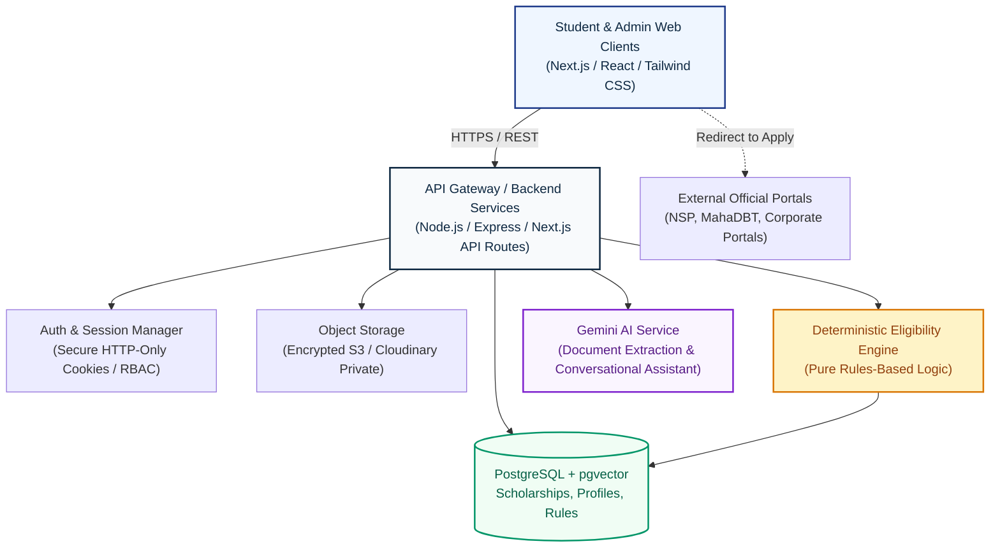

# ScholarSathi Documentation

Welcome to the official technical and product documentation for **ScholarSathi** — an AI-powered scholarship discovery and eligibility portal designed specifically for students across India.

---

## 📌 What is ScholarSathi?

ScholarSathi bridges the information and accessibility gap in the Indian scholarship ecosystem. Millions of rupees in central, state, corporate (CSR), and philanthropic scholarship funds go unclaimed or misallocated each year due to:
- Complex, fragmented eligibility criteria across hundreds of portals (NSP, state portals, private trusts).
- Opaque documentation requirements and missed deadlines.
- Predatory middle-men and lack of guidance for students from rural and tier-2/3 regions.

ScholarSathi solves this by:
1. **Structuring Student Profiles:** Collecting detailed academic, socio-economic, domicile, and category data.
2. **Automated Document Intelligence:** Utilizing server-side Google Gemini models to extract structured verification fields from government-issued certificates (Income, Caste, Domicile, Marksheets).
3. **Deterministic Eligibility Engine:** Guaranteeing accurate, rules-based qualification checks (verifying income caps, category quotas, domicile, and academic thresholds) rather than relying on probabilistic AI guesses.
4. **Transparent AI Guidance:** Providing a conversational assistant powered by Gemini with function calling to explain criteria, answer queries, and guide students step-by-step to the **official application portals**.
5. **Full Lifecycle Tracking:** Managing document readiness, deadline alerts, and official application status tracking.

---

## 📚 Document Index & Purpose

The `/docs` directory is organized into specialized, implementation-ready specifications. Every document is designed to be cohesive, practical, and directly translatable to production code.

| Document | Primary Audience | Description & Scope |
| :--- | :--- | :--- |
| [**PRD.md**](./PRD.md) | Product Managers, Tech Leads, QA | **Product Requirements Document**: Vision, user personas, core user journeys, functional requirements (with IDs), non-functional requirements, and MVP vs. future roadmap. |
| [**UI-UX.md**](./UI-UX.md) | Frontend Engineers, UI/UX Designers | **UI/UX Design Specification**: Clean, professional, trustworthy light-theme design system, color tokens, typography, accessibility standards (WCAG 2.1 AA), and specifications for all 16 distinct screens. |
| [**TRD.md**](./TRD.md) | Backend/Frontend Engineers, DevOps | **Technical Requirements Document**: System architecture, technology stack (Next.js, Node.js, PostgreSQL, pgvector, Gemini API), complete REST API specifications, Gemini extraction schemas, and error handling. |
| [**DB-SCHEMA.md**](./DB-SCHEMA.md) | Database Architects, Backend Engineers | **Database Schema & Data Models**: Full PostgreSQL production schema with 17 normalized tables, column data types, constraints, foreign keys, indexes, and Mermaid ER diagram. |
| [**DESIGN.md**](./DESIGN.md) | System Architects, Senior Developers | **System Design Document**: High-level component interactions, data flow sequence diagrams, deterministic eligibility pipeline, AI agent tool calling architecture, and failure resilience strategies. |
| [**SECURITY.md**](./SECURITY.md) | Security Engineers, Compliance Officers | **Security & Privacy Specification**: Strict file upload sandboxing, server-side Gemini credential safety, prompt injection defenses, RBAC authorization, DPDPA 2023 compliance, and audit logging. |
| [**DOCUMENTATION-CHECKLIST.md**](./DOCUMENTATION-CHECKLIST.md) | Tech Lead, QA, Reviewers | **Traceability & Verification Checklist**: Direct cross-validation between requirements, APIs, database entities, and security guarantees. |

---

## 🧭 Recommended Reading Order for Developers

To gain a complete, cohesive understanding before writing any code, follow this sequence:

```mermaid
flowchart LR
    A["1. PRD.md<br/>(Understand Problem & Scope)"] --> B["2. UI-UX.md<br/>(Understand User Flows & Screens)"]
    B --> C["3. TRD.md<br/>(Understand Tech Stack & APIs)"]
    C --> D["4. DB-SCHEMA.md<br/>(Understand Data Models)"]
    D --> E["5. DESIGN.md<br/>(Understand Engine & AI Logic)"]
    E --> F["6. SECURITY.md<br/>(Understand Rules & Hardening)"]
    F --> G["7. CHECKLIST.md<br/>(Validate Alignment)"]

    style A fill:#E2E8F0,stroke:#0F2942,stroke-width:2px,color:#0F2942
    style B fill:#E2E8F0,stroke:#0F2942,stroke-width:2px,color:#0F2942
    style C fill:#E2E8F0,stroke:#0F2942,stroke-width:2px,color:#0F2942
    style D fill:#E2E8F0,stroke:#0F2942,stroke-width:2px,color:#0F2942
    style E fill:#E2E8F0,stroke:#0F2942,stroke-width:2px,color:#0F2942
    style F fill:#E2E8F0,stroke:#0F2942,stroke-width:2px,color:#0F2942
    style G fill:#DCFCE7,stroke:#059669,stroke-width:2px,color:#059669
```

1. **Start with [PRD.md](./PRD.md)** to grasp business logic, student personas, and functional boundaries.
2. **Review [UI-UX.md](./UI-UX.md)** to visualize the clean, accessible interface and user interactions.
3. **Examine [TRD.md](./TRD.md)** to understand the API contracts and service boundaries.
4. **Study [DB-SCHEMA.md](./DB-SCHEMA.md)** to inspect the relational schema, machine-readable rule structures, and indexes.
5. **Inspect [DESIGN.md](./DESIGN.md)** to master the multi-stage deterministic eligibility engine and Gemini tool-calling patterns.
6. **Consult [SECURITY.md](./SECURITY.md)** to implement strict file validation, secret isolation, and data protection rules.
7. **Verify via [DOCUMENTATION-CHECKLIST.md](./DOCUMENTATION-CHECKLIST.md)** that implementation aligns with all non-negotiable guidelines.

---

## 🏛️ High-Level Architectural Snapshot

---

## 🛠️ Technology Stack Summary

- **Frontend:** Next.js 14+ (App Router), React 18+, TypeScript, Tailwind CSS (Custom clean light-theme token palette).
- **Backend:** Node.js, Express / Next.js Server Endpoints, TypeScript, Zod Schema Validation.
- **Database:** PostgreSQL 15+ with `pgvector` for semantic search and index-backed relational filtering.
- **AI & Document Intelligence:** Google Gemini API (Server-side `@google/genai` SDK using Gemini Flash for rapid extraction and Gemini Pro for complex conversational guidance).
- **File Storage:** Private S3-compatible Object Storage with time-limited pre-signed URLs.
- **Security & Auth:** Argon2id password hashing, HTTP-only secure SameSite cookies, CSRF protection, Helmet security headers, ClamAV file sanitization.

---

## 📋 Documentation Maintenance & Change Rules

1. **Source of Truth:** If an API endpoint or schema change is required, update `TRD.md` and `DB-SCHEMA.md` first before modifying code.
2. **Deterministic Rules Guarantee:** Never delegate deterministic math, percentage eligibility, or income cutoffs to Gemini prompts. All hard rule checks must remain in `DESIGN.md` and the backend eligibility engine.
3. **No Secret Leaks:** Never commit API keys, service credentials, or private keys to the repository or documentation files.
4. **Light Theme Invariance:** UI designs must adhere strictly to the professional, high-contrast light theme defined in `UI-UX.md`.
