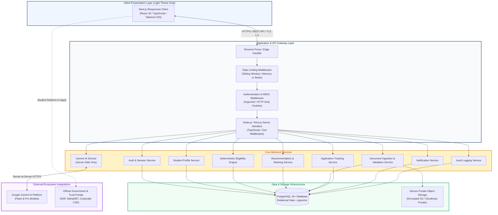
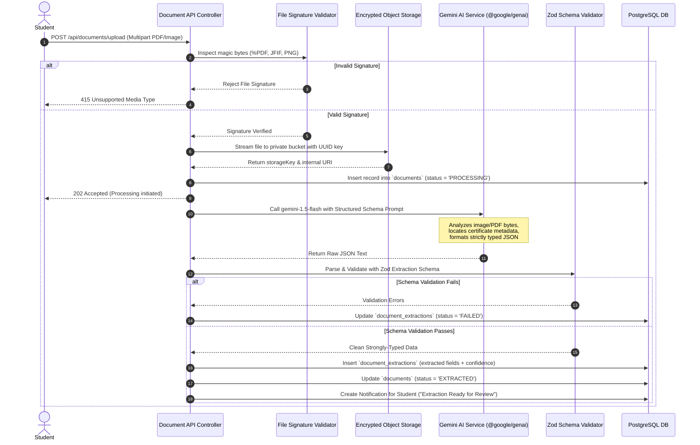

# Technical Requirements Document (TRD)

## Project: ScholarSathi
**Document Version:** 1.0.0  
**Status:** Approved for Engineering Implementation  
**Primary Tech Stack:** Next.js, Node.js, TypeScript, PostgreSQL (with pgvector), Google Gemini API, Tailwind CSS, Docker

---

## 1. Executive Technical Summary & System Architecture

ScholarSathi is architected as a modular, high-performance web platform adhering to strict separation of concerns, deterministic business logic execution, and zero client-side exposure of artificial intelligence credentials.

### 1.1 Core Technology Stack

| Layer | Technology Selected | Rationale & Specifications |
| :--- | :--- | :--- |
| **Frontend Framework** | **Next.js 14+ (App Router) & React 18+** | Server-side rendering (SSR) for blazing-fast SEO on public scholarship listings; lightweight client hydration; strict TypeScript typings. |
| **Styling & Design System** | **Tailwind CSS (Custom Token System)** | Strictly scoped Light Theme palette; zero arbitrary inline CSS; high-contrast WCAG 2.1 AA tokens. |
| **Backend & API Layer** | **Node.js (Next.js API Routes / Modular Express Engine)** | Shared TypeScript types between frontend and backend; lightweight footprint; Zod-based request validation middleware. |
| **Relational & Vector DB** | **PostgreSQL 15+ with `pgvector`** | ACID compliance for profile records and applications; B-tree indexes for deterministic rules; `pgvector` for semantic scholarship discovery. |
| **AI Intelligence Service** | **Google Gemini API (`@google/genai` Server SDK)** | Gemini Flash for rapid multimodal document OCR and extraction; Gemini Pro for conversational guidance and tool-calling; strictly server-side. |
| **Object & File Storage** | **S3-Compatible Storage (AWS S3 / MinIO / Cloudinary Private)** | Encrypted bucket storage for student documents; private access restricted via 15-minute time-limited pre-signed URLs. |
| **Authentication & AuthZ** | **Argon2id + HTTP-Only SameSite Cookies + RBAC** | Cryptographic security against timing attacks; XSS-immune cookie sessions; role-based guards (`STUDENT`, `ADMIN`, `SUPER_ADMIN`). |
| **Containerization** | **Docker & Docker Compose** | Reproducible multi-stage builds; independent container services for Web/API, PostgreSQL, and Storage emulator. |

---

### 1.2 System Architecture Diagram



---

## 2. Comprehensive REST API Specifications

All endpoints communicate over HTTPS using JSON payloads. Requests containing a body must include `Content-Type: application/json` unless multipart form data is explicitly required.

### 2.1 Standardized API Response Contracts

#### Success Response
```json
{
  "success": true,
  "data": {},
  "meta": {
    "requestId": "req_01h6z8k3m8a",
    "timestamp": "2026-10-04T12:00:00.000Z"
  }
}
```

#### Error Response (RFC 7807 Compliant)
```json
{
  "success": false,
  "error": {
    "code": "VALIDATION_FAILED",
    "message": "Invalid request parameters provided.",
    "details": [
      {
        "field": "familyAnnualIncome",
        "issue": "Income must be a non-negative number."
      }
    ]
  },
  "meta": {
    "requestId": "req_01h6z8k3m8a",
    "timestamp": "2026-10-04T12:00:00.000Z"
  }
}
```

---

### 2.2 Authentication Endpoints

#### 1. `POST /api/auth/register`
- **Purpose:** Register a new student account.
- **Auth Required:** No (Public).
- **Request Body:**
  ```json
  {
    "email": "ramesh.patil@example.com",
    "password": "SecurePassword123!",
    "firstName": "Ramesh",
    "lastName": "Patil",
    "phone": "+919876543210"
  }
  ```
- **Validation:**
  - `email`: Valid RFC 5322 format, lowercase, max 255 chars.
  - `password`: Min 8 chars, at least 1 uppercase, 1 lowercase, 1 number, 1 symbol.
  - `phone`: Optional, valid 10-digit Indian mobile format with `+91`.
- **Response (201 Created):**
  ```json
  {
    "success": true,
    "data": {
      "userId": "usr_9b1deb4d-3b7d-4bad-9bdd-2b0d7b3dcb6d",
      "email": "ramesh.patil@example.com",
      "role": "STUDENT",
      "isVerified": false
    }
  }
  ```
- **Errors:** `400 Bad Request` (Validation issue), `409 Conflict` (Email already registered).

#### 2. `POST /api/auth/login`
- **Purpose:** Authenticate user and issue secure HTTP-Only cookie.
- **Auth Required:** No (Public).
- **Request Body:**
  ```json
  {
    "email": "ramesh.patil@example.com",
    "password": "SecurePassword123!"
  }
  ```
- **Validation:** Valid email and non-empty password.
- **Response Headers:** `Set-Cookie: ss_session=...; HttpOnly; Secure; SameSite=Strict; Path=/; Max-Age=604800`
- **Response (200 OK):**
  ```json
  {
    "success": true,
    "data": {
      "userId": "usr_9b1deb4d-3b7d-4bad-9bdd-2b0d7b3dcb6d",
      "role": "STUDENT",
      "firstName": "Ramesh",
      "lastName": "Patil"
    }
  }
  ```
- **Errors:** `400 Bad Request`, `401 Unauthorized` (Invalid credentials), `429 Too Many Requests` (Rate limit exceeded: 5 attempts per 15 mins).

#### 3. `POST /api/auth/logout`
- **Purpose:** Invalidate session and clear HTTP-only cookie.
- **Auth Required:** Yes (`STUDENT`, `ADMIN`, `SUPER_ADMIN`).
- **Request Body:** `{}`
- **Response Headers:** `Set-Cookie: ss_session=; HttpOnly; Secure; SameSite=Strict; Path=/; Max-Age=0`
- **Response (200 OK):** `{"success": true, "data": {"message": "Logged out successfully."}}`

#### 4. `GET /api/auth/me`
- **Purpose:** Return current authenticated user session context.
- **Auth Required:** Yes.
- **Response (200 OK):** Returns user ID, role, email, profile completion flag.
- **Errors:** `401 Unauthorized`.

---

### 2.3 Student Profile Endpoints

#### 1. `GET /api/profile`
- **Purpose:** Fetch complete personal, socio-economic, and academic profile for authenticated student.
- **Auth Required:** Yes (`STUDENT`).
- **Response (200 OK):**
  ```json
  {
    "success": true,
    "data": {
      "profileId": "sp_123e4567-e89b-12d3-a456-426614174000",
      "firstName": "Ramesh",
      "lastName": "Patil",
      "dob": "2005-08-14",
      "gender": "MALE",
      "domicileState": "Maharashtra",
      "domicileDistrict": "Pune",
      "category": "OBC",
      "religion": "HINDU",
      "familyAnnualIncome": 235000,
      "isDisabled": false,
      "disabilityPercentage": null,
      "minorityStatus": false,
      "profileCompleteness": 85,
      "education": {
        "currentLevel": "UNDERGRADUATE",
        "courseName": "B.Tech",
        "specialization": "Computer Engineering",
        "institutionName": "Government College of Engineering, Pune",
        "institutionState": "Maharashtra",
        "currentYear": 2,
        "percentageOrCgpa": 78.4,
        "gradingScale": "PERCENTAGE"
      }
    }
  }
  ```

#### 2. `PUT /api/profile`
- **Purpose:** Update personal and socio-economic profile information.
- **Auth Required:** Yes (`STUDENT`).
- **Request Body:**
  ```json
  {
    "domicileState": "Maharashtra",
    "domicileDistrict": "Pune",
    "category": "OBC",
    "religion": "HINDU",
    "familyAnnualIncome": 235000,
    "isDisabled": false,
    "minorityStatus": false
  }
  ```
- **Validation:** Zod schema enforcing recognized Indian States/UTs, valid category enum (`GENERAL`, `SC`, `ST`, `OBC`, `EWS`), non-negative income integer.
- **Response (200 OK):** Returns updated profile and re-calculated profile completeness score.

#### 3. `PUT /api/profile/academic`
- **Purpose:** Update current education and academic performance details.
- **Auth Required:** Yes (`STUDENT`).
- **Request Body:**
  ```json
  {
    "currentEducationLevel": "UNDERGRADUATE",
    "courseName": "B.Tech",
    "specialization": "Computer Engineering",
    "institutionName": "Government College of Engineering, Pune",
    "institutionState": "Maharashtra",
    "boardOrUniversity": "Savitribai Phule Pune University",
    "currentYearOrSemester": 2,
    "passingYear": 2027,
    "percentageOrCgpa": 78.4,
    "gradingScale": "PERCENTAGE"
  }
  ```
- **Validation:** Academic score must be between 0–100 for PERCENTAGE or 0–10 for CGPA.
- **Response (200 OK):** Returns updated academic profile.

---

### 2.4 Scholarship Discovery & Recommendations

#### 1. `GET /api/scholarships`
- **Purpose:** Search and filter the global scholarship catalog.
- **Auth Required:** No (Publicly accessible; enriched with personalized status if authenticated).
- **Query Parameters:**
  - `q`: Search keyword (string, e.g. "engineering")
  - `providerType`: `GOVERNMENT_CENTRAL`, `GOVERNMENT_STATE`, `PRIVATE_TRUST`, `CORPORATE_CSR`
  - `state`: e.g. "Maharashtra"
  - `category`: `OBC`, `SC`, `ST`, `EWS`, `GENERAL`
  - `educationLevel`: `UNDERGRADUATE`, `POSTGRADUATE`, etc.
  - `gender`: `ALL`, `FEMALE_ONLY`
  - `status`: `OPEN`, `UPCOMING`, `CLOSED`
  - `page`: default 1
  - `limit`: default 20 (max 100)
- **Response (200 OK):**
  ```json
  {
    "success": true,
    "data": {
      "scholarships": [
        {
          "id": "sch_550e8400-e29b-41d4-a716-446655440000",
          "title": "MahaDBT Post-Matric Scholarship for OBC Students",
          "slug": "mahadbt-post-matric-obc",
          "providerName": "Government of Maharashtra (OBC Welfare Dept)",
          "providerType": "GOVERNMENT_STATE",
          "financialAssistance": "100% Tuition & Exam Fee Reimbursement",
          "applicationDeadline": "2026-11-30T23:59:59.000Z",
          "officialPortalUrl": "https://mahadbt.maharashtra.gov.in",
          "daysRemaining": 57,
          "isFeatured": true
        }
      ],
      "pagination": { "page": 1, "limit": 20, "total": 142, "totalPages": 8 }
    }
  }
  ```

#### 2. `GET /api/scholarships/:id`
- **Purpose:** Get full details, criteria breakdown, document checklist, and official portal link.
- **Auth Required:** Optional.
- **Response (200 OK):**
  ```json
  {
    "success": true,
    "data": {
      "id": "sch_550e8400-e29b-41d4-a716-446655440000",
      "title": "MahaDBT Post-Matric Scholarship for OBC Students",
      "description": "Financial assistance for meritorious OBC students enrolled in approved technical and professional degree programs in Maharashtra.",
      "provider": {
        "name": "Directorate of Higher Education, Maharashtra",
        "type": "GOVERNMENT_STATE",
        "websiteUrl": "https://mahadbt.maharashtra.gov.in"
      },
      "awardDetails": {
        "amountDescription": "Full Tuition Waiver + Maintenance Allowance",
        "amountType": "ANNUAL"
      },
      "dates": {
        "startDate": "2026-09-01T00:00:00.000Z",
        "deadline": "2026-11-30T23:59:59.000Z",
        "academicYear": "2026-27"
      },
      "officialPortalUrl": "https://mahadbt.maharashtra.gov.in",
      "eligibilityCriteria": {
        "maxFamilyIncome": 250000,
        "minPercentage": 60.0,
        "allowedCategories": ["OBC", "VJNT", "SBC"],
        "allowedStates": ["Maharashtra"],
        "educationLevels": ["UNDERGRADUATE", "DIPLOMA"]
      },
      "requiredDocuments": [
        { "name": "Income Certificate", "type": "INCOME_CERTIFICATE", "mandatory": true },
        { "name": "Caste Certificate", "type": "CASTE_CERTIFICATE", "mandatory": true },
        { "name": "Domicile Certificate", "type": "DOMICILE_CERTIFICATE", "mandatory": true },
        { "name": "12th Marksheet", "type": "MARKSHEET_12TH", "mandatory": true },
        { "name": "College Fee Receipt", "type": "OTHER", "mandatory": false }
      ]
    }
  }
  ```

#### 3. `GET /api/recommendations`
- **Purpose:** Return student-personalized scholarship recommendations generated by the deterministic engine.
- **Auth Required:** Yes (`STUDENT`).
- **Response (200 OK):**
  ```json
  {
    "success": true,
    "data": {
      "recommendations": [
        {
          "scholarshipId": "sch_550e8400-e29b-41d4-a716-446655440000",
          "title": "MahaDBT Post-Matric Scholarship for OBC Students",
          "matchStatus": "ELIGIBLE",
          "rankingScore": 88.5,
          "matchReasons": [
            "Domicile matches Maharashtra requirement.",
            "OBC category matches eligible list [OBC, VJNT, SBC].",
            "Family income ₹2,35,000 is under the ₹2,50,000 ceiling.",
            "Marks 78.4% satisfy the minimum 60.0% cutoff."
          ],
          "missingDocuments": [],
          "deadline": "2026-11-30T23:59:59.000Z",
          "officialPortalUrl": "https://mahadbt.maharashtra.gov.in"
        }
      ]
    }
  }
  ```

#### 4. `POST /api/scholarships/:id/save` and `DELETE /api/scholarships/:id/save`
- **Purpose:** Bookmark or un-bookmark a scholarship.
- **Auth Required:** Yes (`STUDENT`).
- **Response (200 OK):** `{"success": true, "data": {"saved": true}}`

---

### 2.5 Document Ingestion & Extraction Endpoints

#### 1. `POST /api/documents/upload`
- **Purpose:** Ingest student document, perform magic-number validation, store in object store, and trigger Gemini extraction pipeline.
- **Auth Required:** Yes (`STUDENT`).
- **Request:** `multipart/form-data` with fields:
  - `file`: Binary stream (PDF, JPEG, or PNG; max 5MB).
  - `documentType`: `INCOME_CERTIFICATE`, `CASTE_CERTIFICATE`, `DOMICILE_CERTIFICATE`, `MARKSHEET_10TH`, `MARKSHEET_12TH`, `COLLEGE_MARKSHEET`, etc.
- **Validation:**
  - File size ≤ 5,242,880 bytes.
  - Byte signature verification (`%PDF`, `\xFF\xD8\xFF`, `\x89PNG`).
- **Response (202 Accepted):**
  ```json
  {
    "success": true,
    "data": {
      "documentId": "doc_789e0123-e45b-67d8-a901-234567890000",
      "fileName": "income_cert_2026.pdf",
      "documentType": "INCOME_CERTIFICATE",
      "status": "PROCESSING",
      "message": "File uploaded securely. Gemini extraction pipeline initiated."
    }
  }
  ```

#### 2. `GET /api/documents` & `GET /api/documents/:id`
- **Purpose:** List student's uploaded documents and view extracted values.
- **Auth Required:** Yes (`STUDENT` owning document, or `ADMIN`).
- **Response (200 OK):** Returns document metadata, verification status, and pre-signed view URL (15-min TTL).

#### 3. `POST /api/documents/:id/verify`
- **Purpose:** Student confirms or manually edits extracted fields to update official profile attributes.
- **Auth Required:** Yes (`STUDENT`).
- **Request Body:**
  ```json
  {
    "confirmedIncome": 235000,
    "confirmedFinancialYear": "2026-27",
    "confirmedState": "Maharashtra"
  }
  ```
- **Response (200 OK):** `{"success": true, "data": {"status": "VERIFIED"}}`

---

### 2.6 AI Conversational Assistant Endpoints

#### 1. `POST /api/ai/chat`
- **Purpose:** Send user query to the contextual Gemini assistant with tool-calling capabilities.
- **Auth Required:** Yes (`STUDENT`).
- **Request Body:**
  ```json
  {
    "conversationId": "conv_990e1111-e22b-33c4-d555-667788990000",
    "message": "Why does the Tata Trust scholarship say I need verification?",
    "contextScholarshipId": "sch_550e8400-e29b-41d4-a716-446655440000"
  }
  ```
- **Validation:** `message` string (1–1000 characters).
- **Response (200 OK):**
  ```json
  {
    "success": true,
    "data": {
      "conversationId": "conv_990e1111-e22b-33c4-d555-667788990000",
      "reply": "The Tata Trust Merit Scholarship marked your profile as 'Needs Verification' because it requires an active College Bonafide Certificate stamped by your Head of Department. Your profile currently does not have a Bonafide Certificate uploaded in the documents tab.",
      "toolsUsed": ["checkEligibility", "getRequiredDocuments"],
      "suggestedAction": {
        "type": "UPLOAD_DOCUMENT",
        "targetDocument": "BONAFIDE_CERTIFICATE"
      }
    }
  }
  ```

#### 2. `POST /api/ai/explain-eligibility/:scholarshipId`
- **Purpose:** Request plain-English AI synthesis of a deterministic eligibility evaluation.
- **Auth Required:** Yes (`STUDENT`).
- **Response (200 OK):** Returns structured human explanation with criteria breakdown.

---

### 2.7 Application Tracker Endpoints

#### 1. `GET /api/applications`
- **Purpose:** Fetch all tracked applications for the student.
- **Auth Required:** Yes (`STUDENT`).
- **Response (200 OK):** Array of applications with status, dates, and official reference numbers.

#### 2. `POST /api/applications`
- **Purpose:** Create or update a tracked application.
- **Auth Required:** Yes (`STUDENT`).
- **Request Body:**
  ```json
  {
    "scholarshipId": "sch_550e8400-e29b-41d4-a716-446655440000",
    "applicationStatus": "APPLIED_ON_OFFICIAL_PORTAL",
    "officialApplicationId": "MH-OBC-2026-981245",
    "appliedDate": "2026-10-04",
    "notes": "Submitted with Tehsildar income cert and 12th board marksheet."
  }
  ```
- **Response (201 Created):** Application record created.

#### 3. `PUT /api/applications/:id/status`
- **Purpose:** Update status (`UNDER_REVIEW`, `AWARDED`, `REJECTED`).
- **Auth Required:** Yes (`STUDENT`).

---

### 2.8 Protected Admin Endpoints

Protected strictly by RBAC middleware (`role in ['ADMIN', 'SUPER_ADMIN']`).

#### 1. `POST /api/admin/scholarships`
- **Purpose:** Create a new scholarship with structured machine-readable rules.
- **Auth Required:** Yes (`ADMIN`, `SUPER_ADMIN`).
- **Request Body:**
  ```json
  {
    "title": "HDFC Badhte Kadam Scholarship 2026",
    "providerId": "prv_110e2222-e33b-44c5-d666-778899001122",
    "scholarshipType": "CORPORATE_CSR",
    "financialAssistance": "Up to ₹1,00,000 per year",
    "amountType": "ANNUAL",
    "officialPortalUrl": "https://www.hdfcbank.com/csr/scholarships",
    "applicationStartDate": "2026-09-15T00:00:00.000Z",
    "applicationDeadline": "2026-11-15T23:59:59.000Z",
    "academicYear": "2026-27",
    "eligibilityRules": {
      "minPercentage": 60.0,
      "maxFamilyIncome": 600000,
      "allowedCategories": ["GENERAL", "OBC", "SC", "ST", "EWS"],
      "allowedStates": ["ALL"],
      "allowedGenders": ["ALL"],
      "allowedEducationLevels": ["UNDERGRADUATE", "POSTGRADUATE"]
    },
    "requiredDocuments": [
      { "documentType": "INCOME_CERTIFICATE", "isMandatory": true },
      { "documentType": "MARKSHEET_12TH", "isMandatory": true },
      { "documentType": "AADHAAR_CARD", "isMandatory": true }
    ]
  }
  ```
- **Response (201 Created):** Scholarship created and indexed.

#### 2. `PUT /api/admin/scholarships/:id` & `DELETE /api/admin/scholarships/:id`
- **Purpose:** Update or archive scholarship listings.

#### 3. `GET /api/admin/metrics`
- **Purpose:** Platform analytics (active students, application volume, Gemini extraction token usage, engine match latency).

#### 4. `GET /api/admin/audit-logs`
- **Purpose:** Retrieve immutable administrative audit trail.

---

## 3. Server-Side AI Architecture & Gemini Integration

### 3.1 Security & Secret Isolation Guarantee
- **Never expose keys:** The `GEMINI_API_KEY` is loaded solely in server-side runtime environments via encrypted environment variables.
- **No Client Runtimes:** The client application has zero knowledge of Gemini API endpoints or direct Google credentials.
- **Data Minimization:** Prompts sent to Gemini strip all extraneous personal identifiers (e.g., telephone numbers, Aadhaar sequences, residential street addresses).

### 3.2 Document Extraction Pipeline



### 3.3 Gemini Structured JSON Extraction Schema

Gemini Flash is invoked with a strict JSON response schema enforcing the following contract:

```typescript
// Zod Schema for Document Extraction Validation
import { z } from 'zod';

export const DocumentExtractionSchema = z.object({
  documentType: z.enum([
    'INCOME_CERTIFICATE',
    'CASTE_CERTIFICATE',
    'DOMICILE_CERTIFICATE',
    'MARKSHEET_10TH',
    'MARKSHEET_12TH',
    'COLLEGE_MARKSHEET',
    'DISABILITY_CERTIFICATE',
    'BONAFIDE_CERTIFICATE',
    'UNKNOWN'
  ]),
  extractedStudentName: z.string().nullable(),
  issuingState: z.string().nullable(),
  issuingAuthority: z.string().nullable(),
  certificateNumber: z.string().nullable(),
  issuanceDate: z.string().regex(/^\d{4}-\d{2}-\d{2}$/).nullable(),
  validUntilDate: z.string().regex(/^\d{4}-\d{2}-\d{2}$/).nullable(),
  
  // Specific financial certificate fields
  annualIncome: z.number().int().nonnegative().nullable(),
  financialYear: z.string().nullable(),
  
  // Specific social category certificate fields
  casteCategory: z.enum(['GENERAL', 'SC', 'ST', 'OBC', 'EWS', 'OTHER']).nullable(),
  subCaste: z.string().nullable(),
  
  // Specific academic marksheet fields
  totalMarksObtained: z.number().nullable(),
  maximumMarks: z.number().nullable(),
  percentage: z.number().min(0).max(100).nullable(),
  
  // Extraction metadata
  confidenceScore: z.number().min(0).max(1.0),
  isDocumentLegible: z.boolean(),
  notesOrAnomalies: z.string().nullable()
});

export type DocumentExtractionResult = z.infer<typeof DocumentExtractionSchema>;
```

### 3.4 Conversational Assistant Tool-Calling Contract

When interacting via `/api/ai/chat`, the model is equipped with sandboxed server-side tools:

```typescript
export const assistantTools = [
  {
    name: "searchScholarships",
    description: "Search active scholarships in the verified database by keywords, state, category, or degree level.",
    parameters: {
      type: "object",
      properties: {
        keyword: { type: "string" },
        state: { type: "string" },
        category: { type: "string" }
      }
    }
  },
  {
    name: "getScholarshipDetails",
    description: "Retrieve comprehensive criteria, financial assistance amounts, and deadlines for a specific scholarship ID.",
    parameters: {
      type: "object",
      properties: {
        scholarshipId: { type: "string" }
      },
      required: ["scholarshipId"]
    }
  },
  {
    name: "checkEligibility",
    description: "Execute the deterministic engine for the authenticated student against a specific scholarship to get exact rule evaluation.",
    parameters: {
      type: "object",
      properties: {
        scholarshipId: { type: "string" }
      },
      required: ["scholarshipId"]
    }
  },
  {
    name: "getRequiredDocuments",
    description: "Fetch mandatory and optional document requirements for a scholarship.",
    parameters: {
      type: "object",
      properties: {
        scholarshipId: { type: "string" }
      },
      required: ["scholarshipId"]
    }
  }
];
```

---

## 4. Comprehensive Error Handling & Status Matrix

| Error Scenario | HTTP Status | Internal Code | Safe Client Message | Mitigation / Action |
| :--- | :---: | :--- | :--- | :--- |
| **Invalid Schema Input** | `400` | `VALIDATION_ERROR` | *"One or more inputs were invalid. Please check the marked fields."* | Returns specific field-level validation errors from Zod. |
| **Expired / Invalid Session** | `401` | `UNAUTHORIZED` | *"Your session has expired. Please sign in again."* | Clears cookie; client redirects to login screen. |
| **Forbidden Role Action** | `403` | `FORBIDDEN` | *"You do not have permission to perform this administrative action."* | Logs unauthorized attempt to audit log. |
| **Resource Not Found** | `404` | `NOT_FOUND` | *"The requested scholarship or document could not be found."* | Renders friendly empty state in UI. |
| **File Exceeds Size Limit** | `413` | `PAYLOAD_TOO_LARGE` | *"File size exceeds the 5MB maximum limit."* | Instructs user to compress PDF or image. |
| **Disallowed File Type** | `415` | `UNSUPPORTED_MEDIA` | *"Only genuine PDF, JPEG, and PNG files are accepted."* | Rejects stream before disk writing. |
| **Rate Limit Triggered** | `429` | `RATE_LIMITED` | *"Too many requests. Please wait a few minutes before retrying."* | Enforces backoff via `Retry-After` header. |
| **Gemini API Down / Degraded** | `503` | `AI_SERVICE_UNAVAILABLE`| *"Document extraction is temporarily queued. Your document is saved."* | Queues extraction for background retry; platform retains full manual entry capability. |
| **Database Connection Failure** | `500` | `DB_CONNECTION_ERROR` | *"An unexpected error occurred. Our engineering team has been notified."* | Triggers internal alert; connection pool recovers automatically. |

---

## 5. Safe Logging & Observability Guidelines

### 5.1 Non-Negotiable Sanitization Policy
To prevent catastrophic leaks of student privacy and security credentials:
1. **Never Log Secrets:** API keys (`GEMINI_API_KEY`, database credentials, session secrets) must be redacted.
2. **Never Log Auth Credentials:** Passwords, password reset tokens, and cookie strings must never appear in log payloads.
3. **Never Log Sensitive Personal Identifiers:** Student Aadhaar numbers, residential street addresses, or raw bank details must never be written to stdout or third-party log collectors.
4. **Log Request IDs:** Every inbound request is assigned a unique `X-Request-Id` (UUID v4) propagated across all services for cross-trace correlation.

### 5.2 Structured JSON Log Format
All server components output structured JSON logs compatible with Datadog, Grafana Loki, or CloudWatch:

```json
{
  "level": "info",
  "timestamp": "2026-10-04T12:05:30.123Z",
  "requestId": "req_01h6z8k3m8a",
  "userId": "usr_9b1deb4d-3b7d-4bad-9bdd-2b0d7b3dcb6d",
  "service": "scholarship-engine",
  "action": "EVALUATE_ELIGIBILITY",
  "scholarshipId": "sch_550e8400-e29b-41d4-a716-446655440000",
  "outcome": "ELIGIBLE",
  "executionDurationMs": 14.2
}
```
