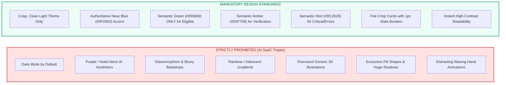

# UI/UX Specification Document

## Project: ScholarSathi
**Document Version:** 1.0.0  
**Design Philosophy:** Human-Centered, Purpose-Driven, Trustworthy, Light Theme Only  
**Target Audience:** Indian Students, Parents, Educational Administrators

---

## 1. Visual Design System & Aesthetics Philosophy

ScholarSathi is an educational and civic empowerment portal, not a trendy SaaS marketing experiment. The user interface must inspire absolute trust, clarity, and institutional legitimacy. Students from rural districts, tier-2/3 colleges, and first-generation academic backgrounds rely on this platform for life-changing financial aid.

### 1.1 Non-Negotiable Visual Rules

---

### 1.2 Curated Color Palette Tokens

Every color in ScholarSathi serves a strict functional and semantic purpose.

| Token Name | Hex Code | Purpose & Application |
| :--- | :--- | :--- |
| `color-bg-base` | `#FFFFFF` | Primary surface background for cards, modals, and content containers. |
| `color-bg-subtle` | `#F8FAFC` | Page body background, neutral section fills, and table headers. |
| `color-border-subtle` | `#E2E8F0` | Default 1px card borders, table row dividers, and input borders. |
| `color-border-hover` | `#CBD5E1` | Interactive borders on card hover and active form element outlines. |
| `color-text-primary` | `#0F172A` | Slate-900: High-contrast primary headings, titles, and critical values. |
| `color-text-secondary` | `#475569` | Slate-600: Body copy, labels, metadata captions, and helper descriptions. |
| `color-text-muted` | `#94A3B8` | Slate-400: Timestamps, placeholder text, and inactive tab labels. |
| **`color-brand-navy`** | **`#0F2942`** | **Primary Brand Color**: Navigation header, primary CTA buttons, official links. |
| `color-brand-navy-hover`| `#1E3A8A` | Hover state for primary buttons and interactive brand anchors. |
| `color-brand-blue-subtle`|`#EFF6FF` | Subtle blue tint for active sidebar navigation item background. |
| **`color-status-eligible`**| **`#059669`** | **Green**: "Eligible" badge, success banners, verified document checkmarks. |
| `color-status-eligible-bg`|`#ECFDF5` | Subtle emerald background tint for eligibility cards. |
| **`color-status-warning`** | **`#D97706`** | **Amber**: "Needs Verification", "Upcoming Deadline (<21d)", pending reviews. |
| `color-status-warning-bg` |`#FFFBEB` | Subtle amber tint for cautionary alerts and missing document prompts. |
| **`color-status-error`**   | **`#DC2626`** | **Red**: "Not Eligible", "Critical Deadline (<7d)", field validation errors. |
| `color-status-error-bg`   |`#FEF2F2` | Subtle red tint for rejection reasons and error callouts. |

---

### 1.3 Typography Hierarchy

The typography uses **Inter** (fallback: `-apple-system, BlinkMacSystemFont, "Segoe UI", Roboto, sans-serif`). It delivers exceptional legibility at small sizes and high rendering clarity across low-cost mobile displays.

- **Page Title (H1):** `font-size: 28px` (`1.75rem`), `font-weight: 700`, `line-height: 1.25`, Color: `#0F172A`.
- **Section Heading (H2):** `font-size: 20px` (`1.25rem`), `font-weight: 600`, `line-height: 1.35`, Color: `#0F172A`.
- **Card Subheading (H3):** `font-size: 16px` (`1.0rem`), `font-weight: 600`, `line-height: 1.4`, Color: `#0F172A`.
- **Body Text:** `font-size: 14px` (`0.875rem`), `font-weight: 400`, `line-height: 1.5`, Color: `#334155`.
- **Micro-Copy / Labels:** `font-size: 12px` (`0.75rem`), `font-weight: 500`, `letter-spacing: 0.025em`, Color: `#64748B`.
- **Monospace (Reference IDs / Amounts):** `font-family: ui-monospace, SFMono-Regular, Menlo, monospace`, `font-size: 13px`.

---

### 1.4 Shape, Elevation, and Form Controls

- **Border Radius:** Restrained and utilitarian.
  - Buttons and inputs: `rounded-md` (`6px`).
  - Cards and dialogs: `rounded-lg` (`8px`).
  - Badges and tags: `rounded` (`4px`).
  - *No pill buttons or circular containers exceeding 8px.*
- **Shadows & Elevation:**
  - Flat base: Default cards use `border: 1px solid #E2E8F0` with no shadow (`shadow-none`).
  - Active hover: `box-shadow: 0 1px 3px 0 rgba(15, 23, 42, 0.08)` (`shadow-sm`).
  - Modal overlay: `box-shadow: 0 10px 15px -3px rgba(15, 23, 42, 0.1)` (`shadow-lg`).
- **Focus Rings:**
  - Standard focus indicator: `outline: 2px solid #0F2942; outline-offset: 2px;`.

---

## 2. Screen-by-Screen UX Specifications

All 16 functional screens are specified below with structural layout, interactive components, edge states, and mobile adaptation.

---

### Screen 1: Public Landing Page (`/`)

- **Purpose:** Inform students and parents about the platform, explain the deterministic verification process, provide a quick eligibility teaser search, and build institutional trust.
- **Layout:**
  - Top Navigation Bar (Logo, "Find Scholarships", "How it Works", "About", "Login", "Register" primary button).
  - Clean Hero Section: Clear headline (*"Discover Scholarships You Actually Qualify For"*), subtext (*"Real-time eligibility checking for central, state, and corporate schemes. Zero spam, zero middle-men."*).
  - Quick Search Bar: Dropdowns for Education Level + Domicile State + Social Category with a *"Check Matching Scholarships"* button.
  - Value Pillar Grid (4 clean cards): Deterministic Eligibility, Document Auto-Extraction, Verified Official Links, Deadline Tracking.
  - Featured & Closing Soon Scholarships carousel/grid (4 cards).
  - Institutional Trust Footer: Disclaimer on official portal redirections, compliance badges, privacy links.
- **Components:** Primary navigation, hero search bar, scholarship summary card, trust badge component.
- **User Actions:** Search without login, browse featured scholarships, click "Sign Up to Check Eligibility".
- **Empty States:** N/A (Static informational page).
- **Loading States:** Skeleton shimmer on featured scholarship cards during initial load.
- **Error States:** Offline banner if internet disconnects.
- **Mobile Behavior:** Quick search stacks vertically; navigation collapses into a standard accessible slide-over drawer.

---

### Screen 2: Student Login (`/login`)

- **Purpose:** Secure authentication for returning students.
- **Layout:** Centered single-column card (max-width: 420px) on `#F8FAFC` background.
- **Components:**
  - ScholarSathi Logo with subtitle *"Sign in to your student portal"*.
  - Email input field with clear label and floating placeholder.
  - Password input field with "Show/Hide Password" toggle icon.
  - "Remember me" checkbox and "Forgot Password?" text link.
  - Primary button: *"Sign In"* (`#0F2942`).
  - Divider: *"Or continue with"*.
  - Secondary button: *"Sign in with Google"* (Standard Google branding, white background, slate border).
  - Bottom link: *"New to ScholarSathi? Create an account"*.
- **User Actions:** Submit credentials, toggle password visibility, trigger password reset flow, authenticate via Google.
- **Empty States:** Empty input validation warnings upon premature submission.
- **Loading States:** Button displays inline spinner with disabled state (*"Signing in..."*).
- **Error States:** Red alert banner above inputs: *"Invalid email or password. Please try again or reset your password."*
- **Mobile Behavior:** Full screen height on mobile with edge-to-edge container padding (16px).

---

### Screen 3: Student Registration (`/register`)

- **Purpose:** Onboard new students with essential account details.
- **Layout:** Centered single-column card (max-width: 480px).
- **Components:**
  - First Name & Last Name (two-column row).
  - Email address input.
  - Mobile Phone Number input (+91 prefix locked).
  - Password creation with live checklist: 8+ characters, 1 number, 1 special symbol.
  - Terms of Service & Privacy Policy consent checkbox.
  - Primary CTA: *"Create Account"* (`#0F2942`).
- **User Actions:** Enter basic credentials, validate password criteria in real-time, submit to proceed directly to Onboarding Wizard.
- **Empty States:** Inline field errors appear only after blur or submit attempt.
- **Loading States:** Button changes to disabled state with loading spinner.
- **Error States:** Duplicate email banner: *"An account with this email already exists. Sign in instead."*
- **Mobile Behavior:** Input fields stack into a clean single column.

---

### Screen 4: Profile Onboarding Wizard (`/onboarding`)

- **Purpose:** Guide student through completing their academic, socio-economic, and domicile profile in structured steps.
- **Layout:** Stepper progress bar at top (4 steps), centered step content card (max-width: 640px), sticky bottom navigation (Back / Next).
- **Steps:**
  1. *Personal & Domicile:* Date of Birth, Gender, State of Domicile (dropdown with all 28 States & 8 UTs), Domicile District.
  2. *Social & Economic:* Category (General, OBC, SC, ST, EWS), Religion, Annual Family Income (INR numeric input with live words preview: *"e.g., ₹2,35,000 = Two Lakh Thirty-Five Thousand"*), Disability status (Yes/No).
  3. *Academic Profile:* Current Level (10th, 12th, UG, PG), Degree/Course (B.Tech, B.Sc, MBBS, etc.), Institution Name, Board/University, Passing Year, Cumulative Marks (Percentage or CGPA).
  4. *Initial Document Prompt:* Optional upload of Income Certificate or Marksheet with prompt: *"Upload now to auto-verify your profile, or skip to finish."*
- **Components:** Horizontal numbered stepper, select dropdowns with search, currency formatter, file drag-and-drop box.
- **User Actions:** Advance between steps, search institution list, skip document upload if documents aren't handy.
- **Empty States:** Mandatory fields prevent advancing to next step with clear error highlight.
- **Loading States:** Shimmer placeholder during step transitions.
- **Error States:** Invalid mark entry (>100% or >10 CGPA) triggers instant inline corrective warning.
- **Mobile Behavior:** Stepper displays as "Step X of 4" counter with horizontal progress fill.

---

### Screen 5: Student Dashboard (`/dashboard`)

- **Purpose:** Central command center for the student summarizing eligible scholarships, upcoming deadlines, document status, and profile health.
- **Layout:** Left sidebar navigation (Dashboard, Search, Documents, Applications, Saved, AI Assistant), top header with search & notification bell, main content split into 2/3 primary feed and 1/3 right-hand widgets.
- **Components:**
  - *Profile Completeness Card:* Progress bar (e.g., 85%), alert chip: *"Add your 12th Marksheet to unlock 3 more scholarships"*.
  - *Eligibility Snapshot Summary:* 3 metric tiles: **Eligible (8)**, **Likely Eligible (4)**, **Needs Verification (2)**.
  - *Top Recommended Scholarships Section:* Ranked cards with green/amber status badges, deadline countdowns, award amounts, and "View Details" buttons.
  - *Upcoming Deadlines Widget (Right Rail):* Mini-calendar list of tracked grants closing in the next 14 days with color-coded urgency tags.
  - *Quick Ask AI Box:* Input chip: *"Ask ScholarSathi AI anything about your eligibility..."*.
- **User Actions:** Click recommendation to view details, jump to profile to fix completeness, open AI assistant drawer.
- **Empty States:** *"No scholarships match your profile yet. Try updating your academic details or exploring the full catalog."*
- **Loading States:** Pulsing card skeletons for metric tiles and recommendation list.
- **Error States:** Toast alert if recommendation engine encounters an intermittent network timeout.
- **Mobile Behavior:** Right rail widgets move below primary recommendations; sidebar collapses to bottom navigation bar (Home, Search, Documents, Tracker, Profile).

---

### Screen 6: Scholarship Search & Catalog (`/scholarships`)

- **Purpose:** Search and explore the entire database of central, state, and private scholarships using multi-dimensional filters.
- **Layout:** Sticky left filter sidebar (desktop: 280px width) + main search results feed with sorting bar (top: Sort by Deadline, Amount, Title).
- **Components:**
  - Search input with clear button and keyboard shortcut (`/`).
  - Filter Facets:
    - Provider Category (Central Govt, State Govt, Corporate CSR, Private Trust).
    - Domicile State (Multi-select dropdown).
    - Caste/Social Category (Checkboxes: General, OBC, SC, ST, EWS).
    - Gender Preference (All, Female Only, Transgender).
    - Education Level (School, Undergraduate, Postgraduate, PhD).
    - Income Limit Range Slider (Up to ₹1L, ₹2.5L, ₹6L, ₹8L+).
  - Scholarship List Item: Title, provider badge, award amount, deadline tag, eligibility tag (if logged in), "Save" bookmark toggle, "View Details" link.
- **User Actions:** Type keywords, check/uncheck facets, toggle sort order, bookmark scholarships.
- **Empty States:** *"No scholarships found matching your filters. Try clearing some filters or searching for broader terms."* with a prominent "Reset All Filters" button.
- **Loading States:** Subtle loader bar across top of results container; cards dim slightly during filter fetch.
- **Error States:** Error banner with retry button if database query fails.
- **Mobile Behavior:** Filter sidebar collapses into a floating bottom button (*"Filters (3 active)"*) opening a full-screen drawer.

---

### Screen 7: Scholarship Details (`/scholarships/[id]`)

- **Purpose:** Full transparency view of a specific scholarship, structured eligibility rules, required document checklist, and verified official application link.
- **Layout:** Breadcrumb navigation, 2-column layout (70% detailed content, 30% sticky action card).
- **Components:**
  - *Header:* Provider name with verified checkmark, title, official scheme code, category tags.
  - *Eligibility Breakdown Table:* Deterministic rule results mapped against student profile:
    - Domicile: Required (Maharashtra) vs Yours (Maharashtra) → **✓ Match**
    - Category: Required (OBC) vs Yours (OBC) → **✓ Match**
    - Family Income: Cap (≤ ₹2,50,000) vs Yours (₹2,35,000) → **✓ Match**
    - Academic Cutoff: Required (≥ 60%) vs Yours (78.4%) → **✓ Match**
  - *AI Explanation Box:* Plain-English breakdown generated by server-side Gemini: *"You are eligible because..."*
  - *Required Documents Checklist:* Mandatory vs Optional documents list with student's upload status (Ready / Missing).
  - *Sticky Action Box (Right):*
    - Award Amount (e.g. ₹50,000/year).
    - Application Deadline with countdown (*"Closes in 18 days"*).
    - Primary Button: *"Apply on Official Portal ↗"* (`#0F2942`).
    - Secondary Action: *"Save to My Tracker"*.
    - Disclaimer note: *"You will be redirected to the official government website. ScholarSathi does not charge any application fee."*
- **User Actions:** Click to redirect to external official portal (opens modal confirmation), bookmark scholarship, click missing document to jump to upload.
- **Empty States:** N/A.
- **Loading States:** Full-page structured shimmer skeleton.
- **Error States:** 404 page if scholarship ID does not exist or has been archived.
- **Mobile Behavior:** Sticky action box docks to bottom of viewport with "Apply Now" button and deadline pill.

---

### Screen 8: AI Scholarship Assistant (`/assistant` or Modal Drawer)

- **Purpose:** Contextual conversational assistant powered by server-side Gemini with tool calling to clarify doubts and guide students.
- **Layout:** Available as a dedicated page or an accessible right-hand drawer (width: 480px on desktop, full-screen on mobile).
- **Components:**
  - Header: *"ScholarSathi Assistant"* with badge *"Grounded in Official Rules"*, close button.
  - Quick Suggestion Chips:
    - *"Why is my profile marked Needs Verification?"*
    - *"What is the income certificate issuing authority in my state?"*
    - *"Can I apply for both government and CSR scholarships?"*
  - Message Stream:
    - Student messages (Right-aligned, slate-100 background, dark text).
    - Assistant messages (Left-aligned, white card, navy border accent, markdown formatting, bullet points).
    - Tool invocation chip (e.g., *"✓ Checked eligibility engine for MahaDBT"*).
  - Input Bar: Text input with character counter (max 1000 chars), send button (`#0F2942`), microphone icon (future voice input).
- **User Actions:** Type query, tap prompt chips, review cited scholarship rules, click embedded scholarship cards.
- **Empty States:** Friendly intro: *"Hello Ramesh! Ask me anything about scholarship eligibility, documents, or deadlines."*
- **Loading States:** Three pulsing dots typing indicator (*"ScholarSathi AI is thinking..."*).
- **Error States:** In-chat message: *"I am currently unable to reach the knowledge service. Please try asking again in a moment."*
- **Mobile Behavior:** Full-screen dialog with smooth slide-up animation and auto-scroll to latest message.

---

### Screen 9: Document Management Vault (`/documents`)

- **Purpose:** Securely upload, inspect, auto-extract, and manage official certificates.
- **Layout:** Top upload drop-zone followed by a clean data table of uploaded documents.
- **Components:**
  - *Upload Drop-Zone:* Drag-and-drop zone with accepted file indicators (`PDF, PNG, JPG up to 5MB`), file browser button.
  - *Document Table / Grid:*
    - Document Type (e.g., Income Certificate).
    - Upload Date & File Name.
    - Status Badge: `PROCESSING` (amber), `EXTRACTED` (blue), `VERIFIED` (green), `REJECTED` (red).
    - Extracted Value Preview (e.g., *"₹2,35,000 / FY 2026-27"*).
    - Actions: View (opens secure pre-signed preview), Edit/Confirm Extracted Values, Delete.
  - *Verification Modal:* Side-by-side view showing uploaded document image/PDF on left and Gemini extracted fields on right for student confirmation.
- **User Actions:** Drag-drop file, view extraction preview, click "Confirm & Sync with Profile", delete outdated certificate.
- **Empty States:** Clean state illustration with text: *"No documents uploaded yet. Upload your Income or Caste certificate to enable automatic eligibility verification."*
- **Loading States:** Progress bar showing upload percentage, followed by an extraction spinner (*"Analyzing certificate with Gemini..."*).
- **Error States:** Rejected file notification: *"Unsupported file format. Please upload a genuine PDF or image."*
- **Mobile Behavior:** Table converts into stacked cards with "Review Extracted Data" primary button.

---

### Screen 10: Application Tracker (`/applications`)

- **Purpose:** Track submissions, record official portal application IDs, and monitor deadlines.
- **Layout:** View toggle (Tabular Table / Stage Columns: Saved, Applied, Under Review, Disbursed, Rejected).
- **Components:**
  - Metric summary: Total Tracked (5), Active Submissions (2), Disbursed Grants (₹50,000).
  - Application Item Card:
    - Scholarship Title & Provider Logo.
    - Official Application ID (e.g., `MH-OBC-2026-981245`).
    - Date Applied.
    - Current Stage dropdown selector.
    - Custom Notes section with inline edit.
    - Next Deadline reminder.
- **User Actions:** Add new tracked application, update status from "Applied" to "Disbursed", add private notes.
- **Empty States:** *"You haven't tracked any applications yet. When you apply on an official portal, click 'Track Application' to manage it here."*
- **Loading States:** Shimmer skeletons for application rows.
- **Error States:** Error toast if status change fails to sync.
- **Mobile Behavior:** List view with expand/collapse accordion for detailed notes.

---

### Screen 11: Saved Scholarships (`/saved`)

- **Purpose:** Quick access to bookmarked scholarships that the student plans to evaluate or apply for later.
- **Layout:** Responsive grid (3 columns desktop, 1 column mobile).
- **Components:**
  - Scholarship card with bookmark icon highlighted in navy.
  - Eligibility badge (`ELIGIBLE`, `LIKELY ELIGIBLE`).
  - Days remaining countdown pill.
  - Actions: "Apply Now" (redirects to details), "Remove from Saved".
- **User Actions:** Remove bookmark, jump to application details.
- **Empty States:** *"No saved scholarships. Browse the catalog and click the bookmark icon on any scholarship to save it here."*
- **Loading States:** Card grid skeletons.
- **Error States:** Standard error retry toast.
- **Mobile Behavior:** Single column card stack.

---

### Screen 12: Notification Center (`/notifications` or Header Dropdown)

- **Purpose:** Centralized log of time-sensitive alerts, deadline warnings, and extraction updates.
- **Layout:** Header dropdown popup (desktop: 380px width) with a "View All Notifications" link to dedicated page.
- **Components:**
  - Header with "Mark all as read" button.
  - Notification items categorized with icon:
    - ⏰ *Deadline Alert:* "MahaDBT Post-Matric OBC closes in 3 days."
    - 📄 *Document Intelligence:* "Income Certificate extraction completed. Click to review."
    - 🎯 *New Match:* "New scholarship added: HDFC Badhte Kadam matches your profile."
  - Timestamp (e.g., "2 hours ago").
  - Unread indicator dot.
- **User Actions:** Click notification to navigate directly to relevant page, mark single/all as read.
- **Empty States:** *"You're all caught up! No unread notifications."*
- **Loading States:** Dropdown loader spinner.
- **Error States:** Inline error notice if notifications fail to fetch.
- **Mobile Behavior:** Dedicated full-screen route (`/notifications`).

---

### Screen 13: Profile Settings & Data Rights (`/settings`)

- **Purpose:** Manage account credentials, communication preferences, and exercise DPDPA data rights.
- **Layout:** 2-column settings layout with left navigation (Account, Notifications, Security, Data Privacy).
- **Components:**
  - *Account:* Email display, mobile phone update with OTP verification.
  - *Security:* Change password form (current password, new password).
  - *Notifications:* Email alerts toggle, In-app alerts toggle, Deadline reminder frequency.
  - *Data Privacy & DPDPA:*
    - "Download Complete Data Profile" button (exports JSON/PDF).
    - "Delete My Account & Documents" button (triggers high-risk confirmation modal with 2-step verification).
- **User Actions:** Update password, toggle alert channels, export profile, request permanent account erasure.
- **Empty States:** N/A.
- **Loading States:** In-place button spinners.
- **Error States:** Password mismatch warnings.
- **Mobile Behavior:** Single column with top tab selector.

---

### Screen 14: Administrator Login (`/admin/login`)

- **Purpose:** Isolated, hardened authentication gateway for scholarship data managers and platform administrators.
- **Layout:** Centered card with distinct administrative banner (*"ScholarSathi Official Admin Gateway"*).
- **Components:**
  - Admin Email input.
  - Password input.
  - Time-based One-Time Password (TOTP / MFA) 6-digit code input.
  - Primary button: *"Sign In to Admin Console"* (`#0F2942`).
- **User Actions:** Authenticate with credentials and 2FA token.
- **Empty States:** Standard form validation.
- **Loading States:** Button loading spinner.
- **Error States:** *"Invalid administrative credentials or expired MFA code."* (Logged to audit service).
- **Mobile Behavior:** Responsive mobile form; recommended for desktop usage.

---

### Screen 15: Administrator Dashboard (`/admin/dashboard`)

- **Purpose:** High-level operational oversight for ScholarSathi platform administrators.
- **Layout:** Top admin header with role badge, sidebar (Overview, Scholarships, Verifications, Audit Logs), 4-metric overview row, and activity tables.
- **Components:**
  - *Key Metric Cards:*
    - Total Registered Students (e.g., 24,510)
    - Active Published Scholarships (e.g., 348)
    - Pending Document Verifications (e.g., 14)
    - Gemini API Health & Latency (e.g., 99.8% / 1.4s avg)
  - *Recent Activity Feed:* Latest scholarship edits, provider updates, system alerts.
  - *Flagged Extractions Queue:* Documents where Gemini confidence score fell below 0.70 for human-in-the-loop review.
- **User Actions:** Jump to pending review items, inspect system health metrics, navigate to scholarship editor.
- **Empty States:** Metric tiles default to 0; empty feeds display *"No pending administrative flags."*
- **Loading States:** Metric skeleton blocks.
- **Error States:** Global error alert if administrative API is unreachable.
- **Mobile Behavior:** Horizontal scroll on data tables; responsive grid for metrics.

---

### Screen 16: Administrator Scholarship Management & Rule Builder (`/admin/scholarships`)

- **Purpose:** Create, edit, publish, and configure machine-readable eligibility rules for scholarships.
- **Layout:** Data table with filters (State, Provider, Status) + "Create New Scholarship" slide-over drawer / full page.
- **Components:**
  - *Scholarship Directory Table:* Title, Provider, Type, Deadline, Status (Draft/Active/Archived), Edit/Archive actions.
  - *Structured Rule Builder:*
    - Maximum Family Income (Numeric INR input).
    - Minimum Academic Cutoff (Percentage numeric input).
    - Eligible Social Categories (Multi-select: General, OBC, SC, ST, EWS).
    - Eligible States of Domicile (Multi-select dropdown or "All India").
    - Gender Restrictions (All, Female Only, Transgender).
    - Eligible Degree Levels (Checkboxes: 10th, 12th, Diploma, UG, PG, PhD).
  - *Document Requirements Selector:* Select mandatory certificates required from student.
  - *Official Portal Link Input:* Validated URL pointing to government or foundation domain.
  - *Test Rule Evaluator:* Interactive widget allowing the administrator to test the new rule against sample student profiles before publishing.
- **User Actions:** Add new scholarship, edit criteria, preview rule matching, toggle publish status.
- **Empty States:** *"No scholarships match the admin filter."*
- **Loading States:** Shimmer table rows.
- **Error States:** Form validation errors if income cap is negative or official URL is malformed.
- **Mobile Behavior:** Desktop optimized.

---

## 3. Accessibility & Usability Engineering (WCAG 2.1 AA)

1. **Strict Contrast Compliance:** All text-to-background combinations meet or exceed a **4.5:1 ratio** for body text and **3:1** for large headings and UI controls.
   - Text `#0F172A` on `#FFFFFF` = **16.1:1** (Passes AAA).
   - Text `#475569` on `#FFFFFF` = **7.5:1** (Passes AAA).
   - Status Green `#059669` on `#ECFDF5` = **5.8:1** (Passes AA).
2. **Keyboard Navigation & Focus Management:**
   - Full keyboard operability via `Tab`, `Shift+Tab`, `Enter`, `Space`, and `Escape`.
   - Distinct, visible focus rings on all interactive elements (`outline: 2px solid #0F2942; outline-offset: 2px`).
   - "Skip to Main Content" landmark anchor placed as the first DOM element on every page.
3. **Screen Reader Support (ARIA):**
   - Semantic HTML5 landmark tags throughout (`<header>`, `<nav>`, `<main>`, `<aside>`, `<footer>`, `<section>`).
   - Dynamic content updates (such as AI chat responses or eligibility changes) announced via `aria-live="polite"`.
   - Modals and drawers implement `aria-modal="true"`, trap keyboard focus while open, and return focus to the triggering element upon close.
4. **Accessible Form Design:**
   - Explicit `<label>` elements associated with every input via `for="input-id"`.
   - Error messages linked directly to invalid inputs using `aria-describedby="field-error-id"`.
   - Form inputs include `aria-invalid="true"` when in an error state.
